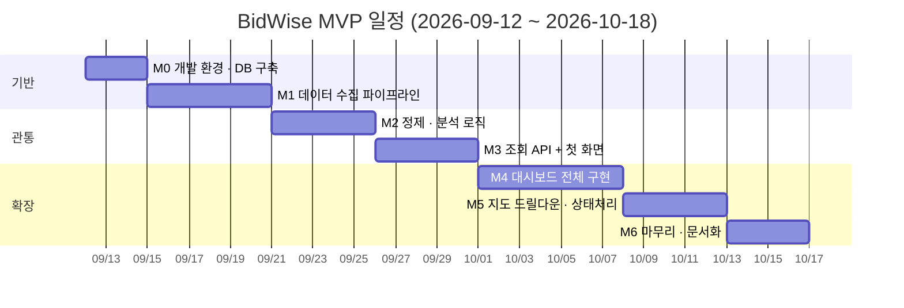

# BidWise — 개발 마일스톤

> 작성일: 2026-09-11
> 목표: ~~입사일(2026-10-19) 전까지 MVP 완성~~ → 2026-10-24 재정비. 새 일정은 미정 (3장 참고)
> 선행 문서: `docs/01_requirements.md` ~ `docs/06_ui_ux.md`

---

## 0. 이 문서를 쓰는 방법

각 마일스톤은 **"완료 기준"이 명확해야** 끝났는지 판단할 수 있다.
"열심히 했다"가 아니라 **"이게 되면 끝"**을 적어둔다.

- 체크박스는 작업할 때마다 직접 채운다
- 마일스톤 하나가 끝날 때마다 커밋한다 (커밋 규칙은 5장)
- 막히면 그 마일스톤을 더 쪼갠다. 일정을 미루기 전에 범위를 먼저 쪼갠다

### 원칙 — 세로로 먼저, 가로로 나중에

기능을 하나씩 완성하는 게 아니라, **가장 얇은 한 줄기를 끝까지 관통시키는 것**을 우선한다.

```
[나쁜 순서] 수집 전부 완성 → 분석 전부 완성 → 화면 전부 완성
           → 마지막 주까지 눈에 보이는 게 없음

[좋은 순서] 공고 10건만 수집 → DB 저장 → API 1개 → 화면에 숫자 1개 표시
           → 이게 되면 나머지는 살 붙이기
```

M3가 이 "관통"의 지점이다. 여기까지 도달하면 남은 건 전부 확장 작업이다.

---

## 1. 전체 일정

> 아래 간트는 2026-09-11에 세운 **원래 계획**이다. M1 도중(2026-09-13) 두 달 멈췄고, 원래 목표일은 지났다.
> 계획과 실제가 어떻게 어긋났는지 남겨두려고 지우지 않는다. 새 일정은 3장 진행 현황에서 관리한다.



| # | 마일스톤 | 기간 | 핵심 산출물 |
|---|---|---|---|
| M0 | 개발 환경 · DB 구축 | 3일 | 로컬에서 테이블이 만들어진다 |
| M1 | 데이터 수집 파이프라인 | 6일 | 실제 공고가 DB에 쌓인다 |
| M2 | 정제 · 분석 로직 | 5일 | 지역·공종별 집계 쿼리가 돈다 |
| M3 | 조회 API + 첫 화면 | 5일 | **브라우저에 실제 숫자가 뜬다** |
| M4 | 대시보드 전체 구현 | 7일 | 지도·차트·필터가 동작한다 |
| M5 | 지도 드릴다운 · 상태 처리 | 5일 | 빈 상태·툴팁까지 완성 |
| M6 | 마무리 · 문서화 | 4일 | README·회고 정리, 배포 판단 |

---

## 2. 마일스톤 상세

### M0 — 개발 환경 · DB 구축 (3일)

> 목표: 코드를 쓸 수 있는 바닥을 깐다

- [x] PostgreSQL 로컬 설치 및 `bidwise` 데이터베이스 생성
- [x] Python 가상환경 + `requirements.txt` 의존성 설치
- [x] `.env` 설정 (`DATABASE_URL`, `DATA_GO_KR_SERVICE_KEY`) — `.gitignore` 확인
- [x] `02_erd.md` 기준으로 SQLAlchemy 모델 작성 (`bid_announcements`, `bid_results`) — `region_normalized`, `category`/`category_source`는 제외하고 M2에서 추가 (근거: `02_erd.md` 6장 참고)
- [x] 테이블 생성 스크립트 실행

**완료 기준**
```
psql에서 \dt 를 쳤을 때 bid_announcements, bid_results 두 테이블이 보인다.
\d bid_announcements 로 컬럼이 ERD 문서와 일치하는지 눈으로 확인된다.
```

**주의할 지점**
- 인증키가 `.env`에만 있고 코드에 하드코딩되지 않았는지 반드시 확인
- `sucsfbid_rate`는 `FLOAT`이 아니라 `NUMERIC(6,3)` (`02_erd.md` 4.2절 근거)
- 금액은 `INTEGER`가 아니라 `BIGINT` (수백억 공사가 존재)

---

### M1 — 데이터 수집 파이프라인 (6일)

> 목표: 나라장터 API에서 실제 데이터를 가져와 DB에 쌓는다

- [x] 나라장터 API 클라이언트 작성 — 입찰공고 (2026-09-12)
- [ ] 나라장터 API 클라이언트 작성 — 낙찰정보
- [x] 페이징 처리 — `numOfRows`, `pageNo` 반복으로 전체 수집 (2026-09-13, 20페이지 실측 검증)
- [ ] `bid_ntce_no` + `bid_ntce_ord` 기준 UPSERT (중복 수집해도 행이 늘지 않게) — `repository/bid_repo.py`에 작성
- [ ] 두 API 결과를 `bid_ntce_no`로 연결해 저장
- [ ] 날짜 문자열 → `datetime` 변환, 금액 문자열 → `int` 변환
- [ ] ~~APScheduler로 일 1회 자동 실행 설정~~ → M3 이후로 이동. 관통 전까지는 수동 실행 스크립트로 충분

#### 재정비 — 기반 코드 정리 (2026-10-24 추가, UPSERT 전에 먼저)

> 코드가 늘어난 뒤에 바꾸면 비싼 것들만 먼저 정리한다. 근거는 DEVLOG 2026-10-24 항목.

- [x] `app/config.py` — `.env` 로딩·키 검증을 한 곳으로 (pydantic-settings)
- [x] `app/database.py` — engine · Session 관리
- [x] Alembic 도입 — 기기 3대의 스키마를 같게 유지, M2 컬럼 추가도 마이그레이션으로 (`0001_initial_schema`)
- [x] 모델을 SQLAlchemy 2.0 스타일(`Mapped[...]`)로, `datetime.utcnow` 교체
- [x] `print` → `logging`, `requirements.txt` 버전 고정 (드라이버 psycopg2 → psycopg 3)
- [x] pytest — 가짜 응답으로 클라이언트 6개, 임시 SQLite로 마이그레이션 2개 (2026-10-24)
- [ ] 실제 PostgreSQL에서 확인 — `.env` 채운 뒤 `alembic stamp 0001` 또는 `upgrade head`, `alembic check`
- [ ] 테스트용 응답 JSON을 실제 API 응답 원문으로 교체 (지금은 뼈대만 본뜬 예시)

**완료 기준**
```
수집 스크립트를 두 번 연속 실행해도 DB 행 수가 늘어나지 않는다. (UPSERT 검증)
최근 1개월치 공사 공고가 수백 건 이상 DB에 들어가 있다.
낙찰결과가 있는 공고와 없는 공고가 둘 다 존재한다. (1:0..1 관계 실증)
```

**주의할 지점**
- **트래픽 한도 1,000건/일** — 초기 대량 적재 시 며칠에 나눠 수집하거나 기간을 좁혀 시작
- 낙찰정보는 **개찰 완료 건에만 존재**한다. 없다고 에러 처리하지 말 것
- API 응답의 빈 문자열 `""`을 `None`으로 정규화해야 DB 타입 변환이 깨지지 않음

---

### M2 — 정제 · 분석 로직 (5일)

> 목표: 원본 데이터를 분석 가능한 형태로 만든다

- [ ] 지역 정규화 — `cnstrtsiteRgnNm`("서울특별시 노원구") → 시/도 단위("서울")
- [ ] `region_normalized` 컬럼 추가 및 인덱스 (`04_api_spec.md` 3.2절 근거)
- [ ] 공종 분류 1차 — `mainCnsttyNm` 값이 있으면 그대로 사용
- [ ] 공종 분류 2차 폴백 — 비어 있으면 `bidNtceNm`(공고명) 키워드로 추정
- [ ] `category`, `category_source` 컬럼 저장 (`source`: `main_cnstty` / `keyword` / `none`)
- [ ] 집계 쿼리 작성 — 요약 / 지역별 / 공종별 (LEFT JOIN 기반)

**완료 기준**
```
psql에서 지역별 GROUP BY 쿼리를 직접 실행했을 때
"서울 / 전체 1,204건 / 완료 892건 / 평균 86.9%" 형태의 결과가 나온다.
category_source가 keyword인 행과 main_cnstty인 행이 둘 다 존재한다.
```

**주의할 지점**
- `INNER JOIN`이 아니라 **`LEFT JOIN`** — 개찰 전 공고가 통계에서 사라지면 안 됨
- `COUNT(*)`는 전체, `COUNT(r.id)`는 완료 건만 — 이 차이로 두 값을 한 쿼리에서 뽑는다
- 공종 키워드 규칙은 완벽할 수 없다. 못 잡으면 `none`으로 두고 넘어갈 것

---

### M3 — 조회 API + 첫 화면 (5일) ★ 관통 지점

> 목표: **브라우저에 실제 데이터가 뜨는 첫 순간을 만든다**

- [ ] FastAPI 프로젝트 구조 세팅 (`main.py`, 라우터 분리)
- [ ] `GET /api/stats/summary` 구현 + Pydantic 응답 스키마
- [ ] `GET /health` 구현 (DB 연결 + 마지막 수집 시각)
- [ ] CORS 설정 (프론트 개발 서버에서 호출 가능하도록)
- [ ] React + TypeScript 프로젝트 생성, shadcn/ui 초기화
- [ ] 디자인 토큰을 CSS 변수로 이식 (`06_ui_ux.md` 1장 팔레트)
- [ ] 요약 카드 4개만 구현해 실제 API 데이터 표시

**완료 기준**
```
브라우저에서 로컬 프론트를 열었을 때,
DB에 실제로 들어있는 숫자가 요약 카드 4개에 표시된다.
Swagger(/docs)에서 summary API를 호출해 200 응답을 확인할 수 있다.
```

**여기가 왜 중요한가**
수집 → 저장 → 집계 → API → 화면까지 **전 구간이 한 번은 연결된 상태**가 된다.
이후 작업은 전부 "이미 연결된 길에 살을 붙이는 것"이라 난이도가 확 낮아진다.

---

### M4 — 대시보드 전체 구현 (7일)

> 목표: Screen 1을 완성한다

- [ ] `GET /api/stats/region` 구현
- [ ] `GET /api/stats/category` 구현 (`source` 필드 포함)
- [ ] `GET /api/meta/regions` 구현
- [ ] 한국 GeoJSON 확보 및 ECharts 지도 연동
- [ ] 지역별 낙찰률 코로플레스 표현 (5단계 블루 스케일)
- [ ] 지역 랭킹 패널 (Progress 컴포넌트)
- [ ] 공종별 막대차트 (Recharts) + `source` 배지
- [ ] 필터바 — 기간 세그먼트 / 지역·공종·계약방법 Select
- [ ] 필터 변경 시 3개 API 재호출 및 화면 동기화

**완료 기준**
```
필터에서 기간을 바꾸면 요약 카드·지도·차트가 모두 함께 갱신된다.
지도에서 지역별로 색이 다르게 칠해진다.
```

**주의할 지점**
- 필터 변경 시 API 3개가 동시에 나가야 한다 (`Promise.all` — 순차 호출하면 3배 느림)
- `avg_sucsfbid_rate`가 `null`인 지역도 지도에 "데이터 없음" 색으로 표시해야 함
- 한국 GeoJSON의 지역명과 `region_normalized` 값이 정확히 매칭되는지 확인 필요

---

### M5 — 지도 드릴다운 · 상태 처리 (5일)

> 목표: Screen 2 · 4 · 5를 완성한다

- [ ] `GET /api/bids` 구현 (페이지네이션, `result` 중첩 객체 포함)
- [ ] 지도 클릭 → 지역 선택 상태 (선택 강조 + 나머지 흐림)
- [ ] 공고 리스트 패널 (낙찰완료 / 개찰 전 상태 분기)
- [ ] 정렬 기능 (최신순 / 낙찰률순 / 금액순)
- [ ] 빈 상태 화면 — 무슨 일 / 왜 / 뭘 하면 되는지 3단 구성
- [ ] 용어 Popover 8종 구현 (`06_ui_ux.md` 6장 사전 기준)
- [ ] 로딩 상태 처리 (스켈레톤 또는 최소한의 로딩 표시)
- [ ] 에러 상태 처리 (API 실패 시 화면이 깨지지 않도록)

**완료 기준**
```
지도에서 지역을 클릭하면 해당 지역 공고 목록이 뜨고,
목록 안에 "낙찰완료" 카드와 "개찰 전" 카드가 섞여 표시된다.
결과가 0건인 필터 조합을 걸면 빈 상태 화면이 안내와 함께 나타난다.
용어 옆 ? 를 클릭하면 설명 팝오버가 뜨고, 바깥을 클릭하면 닫힌다.
```

---

### M6 — 마무리 · 문서화 (4일)

> 목표: 남에게 보여줄 수 있는 상태로 만든다

- [ ] README 작성 — 프로젝트 소개, 스크린샷, 실행 방법
- [ ] 설계 문서 6종 최신화 (구현하며 바뀐 결정사항 반영)
- [ ] 미결정 사항 정리 — 해결된 것 체크, 남은 것은 이유와 함께 기록
- [ ] 코드 정리 — 사용하지 않는 파일·주석 제거
- [ ] 트러블슈팅 기록 (`docs/troubleshooting.md`) — 겪은 버그와 해결법
- [ ] 배포 여부 결정 및 실행 (선택)

**완료 기준**
```
이 저장소를 처음 보는 사람이 README만 읽고 로컬에서 실행할 수 있다.
```

---

## 3. 진행 현황

| 마일스톤 | 상태 | 완료일 |
|---|---|---|
| 설계 (문서 6종 + Figma 목업) | ✅ 완료 | 2026-09-11 |
| M0 개발 환경 · DB 구축 | ✅ 완료 | 2026-09-12 |
| M1 데이터 수집 파이프라인 | 🟡 진행 중 — 입찰공고 클라이언트·페이징 완료, 2026-10-24 재정비 후 UPSERT부터 재개 | |
| M2 정제 · 분석 로직 | ⬜ 예정 | |
| M3 조회 API + 첫 화면 | ⬜ 예정 | |
| M4 대시보드 전체 구현 | ⬜ 예정 | |
| M5 지도 드릴다운 · 상태 처리 | ⬜ 예정 | |
| M6 마무리 · 문서화 | ⬜ 예정 | |

---

## 4. 일정이 밀릴 때의 우선순위

처음엔 5주로 여유 있게 잡은 일정이었다. 밀릴 경우를 대비해 **버릴 순서를 미리 정해둔다.**
급할 때 무엇을 버릴지 정해두지 않으면, 정작 중요한 것을 버리게 된다.

| 순위 | 항목 | 판단 |
|---|---|---|
| 1순위로 버림 | 배포 (M6) | 로컬 실행만으로도 프로젝트는 성립 |
| 2순위 | 정렬 기능 (M5) | 리스트가 보이기만 해도 핵심은 충족 |
| 3순위 | 용어 Popover (M5) | 아쉽지만 없어도 기능은 동작 |
| 4순위 | 공종별 차트 (M4) | 지도가 이 프로젝트의 정체성이므로 차트가 후순위 |
| **절대 안 버림** | M0~M3 전 구간 | 여기가 끊기면 프로젝트 자체가 성립하지 않음 |
| **절대 안 버림** | 지도 (M4) | `05_usecase_sequence.md` 3장에서 정의한 차별점 |

---

## 5. 작업 규칙

### 커밋

마일스톤 하나가 끝날 때마다, 그리고 의미 있는 단위 작업마다 커밋한다.

```
Summary:     feat/fix/docs/refactor: 무엇을 했는지

Description:
## 왜 이렇게 했나
(판단의 근거 — 나중에 면접에서 설명할 수 있도록 한국어로)

## 새 파일 / 수정 파일
- 경로: 역할

## 겪은 오류와 해결
(있는 경우만)
```

### 세션 관리

- **마일스톤 하나당 세션 하나**로 분리한다. 컨텍스트가 섞이면 판단이 흐려진다
- 새 세션을 시작할 때 `DEVLOG.md` "현재 상태"와 이 `MILESTONES.md`를 먼저 읽는다
- 2026-10-24부터 claude.ai 채팅 대신 Claude Code로 작업한다. 저장소를 직접 읽으므로 Project Knowledge 수동 동기화는 하지 않는다
- 발견한 문제는 **발견한 세션 안에서** DEVLOG에 적는다. "마지막에 한 번에"는 세션이 끊기면 사라진다

### 검증 습관

- 코드는 기본적으로 Claude가 작성하고, 직접 타이핑하며 익힐 부분은 작업 시작 전에 정한다 (2026-10-24 변경, 이전 규칙: "코드를 붙여넣지 말고 직접 타이핑하며 이해한다")
- 각 단계에서 **눈으로 확인 가능한 증거**를 만든다 (psql 결과, Swagger 응답, 브라우저 화면)
- 돌아가는 걸 확인한 뒤에 다음 단계로 넘어간다

---

## 6. 입사 이후 계획

M6까지 끝난 뒤에도 이 프로젝트는 끝이 아니다.
입사 후 실무에서 얻은 지식으로 되돌아와 검증할 지점들:

- 공종 분류 기준이 실무 감각과 맞는지 (현업에서는 어떤 단위로 나누는지)
- 낙찰률 외에 실무자가 실제로 중요하게 보는 지표가 무엇인지
- 실제 적산 업무에서 쓰는 프로그램과 이 도구의 관점 차이
- 확장 아이디어 백로그 — 입찰 혼잡도, 발주계획 연동, 사전규격 정보
