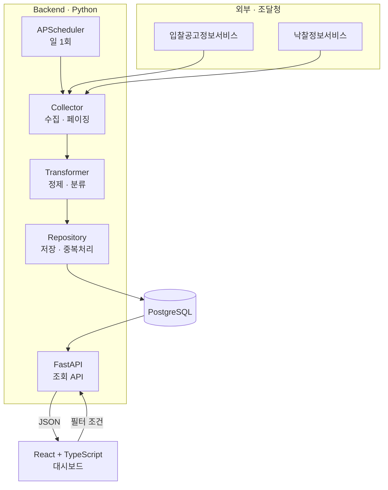
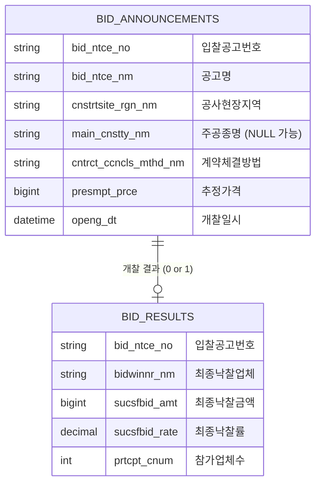
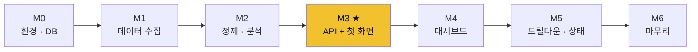

# BidWise

> 조달청 나라장터 공사 입찰 데이터를 수집·분석해, 지역별·공종별 낙찰 경향을 지도와 차트로 조망하는 웹 대시보드

[](./MILESTONES.md)
[](#기술-스택)
[](#기술-스택)
[](#기술-스택)

---

## 한 문장 소개

나라장터에서 공사 입찰 데이터를 **수집**하고, 지역·공종별 낙찰률을 **분석**해, 지도와 차트로 **시각화**하고, 조건별로 **필터링**해 볼 수 있는 서비스.

---

## 왜 만들었나

건설공사비 산정(적산) 분야를 데이터 관점에서 이해하기 위한 학습 프로젝트다.

기존에도 입찰 정보를 다루는 서비스는 여럿 있지만, 대부분 **실제로 입찰에 참여하려는 업체**를 위한 실무 도구다. 이들의 핵심 질문은 "이 공고에 얼마를 써야 낙찰될까?"이고, 그래서 화면이 리스트·순위표·계산기 중심으로 구성된다.

BidWise는 다른 질문에서 출발한다.

> **"전국적으로 낙찰 경향이 어떻게 분포하는가?"**

이 질문에는 개별 공고 리스트보다 **지도**가 더 잘 답한다. 조사해본 결과 기존 서비스들은 지도 시각화를 제공하지 않는데, 이는 그들이 놓쳐서가 아니라 사용자의 목적이 다르기 때문이다. BidWise는 경쟁 서비스가 아니라, 같은 데이터를 다른 각도에서 보는 도구다.

---

## 핵심 지표 — 낙찰률

이 서비스의 모든 분석은 **낙찰률** 하나를 축으로 돈다.

```
낙찰률 = 낙찰금액 ÷ 예정가격 × 100
```

정부가 "이 공사는 10억쯤 들겠다"고 잡아둔 금액이 **예정가격**이고, 실제로 9억에 공사를 따냈다면 낙찰률은 **90%**다. 낙찰률이 낮을수록 그만큼 경쟁이 치열했다는 뜻이다.

> 이 값은 직접 계산하지 않고 나라장터 API가 제공하는 `sucsfbidRate`를 그대로 쓴다. 이유는 [`docs/02_erd.md` 5.3절](./docs/02_erd.md) 참고.

---

## 화면

Figma 하이파이 목업: **[BidWise — UI Mockup](https://www.figma.com/design/1U0pJWd9aJGnNgIOTz4voD/BidWise-%E2%80%94-UI-Mockup)**

| 화면 | 설명 | 바로가기 |
|---|---|---|
| 메인 대시보드 | 요약 통계 · 지역별 지도 · 공종별 차트 · 필터 | [`?node-id=1-19`](https://www.figma.com/design/1U0pJWd9aJGnNgIOTz4voD/BidWise-%E2%80%94-UI-Mockup?node-id=1-19) |
| 지역 선택 → 공고 목록 | 지도 클릭 시 해당 지역 공고 리스트로 드릴다운 | [`?node-id=4-447`](https://www.figma.com/design/1U0pJWd9aJGnNgIOTz4voD/BidWise-%E2%80%94-UI-Mockup?node-id=4-447) |
| 토큰 & 컴포넌트 | 디자인 토큰 · 컴포넌트 상태 · 용어 사전 | [`?node-id=6-2`](https://www.figma.com/design/1U0pJWd9aJGnNgIOTz4voD/BidWise-%E2%80%94-UI-Mockup?node-id=6-2) |
| 빈 상태 | 조건에 맞는 결과가 0건일 때 | [`?node-id=12-2`](https://www.figma.com/design/1U0pJWd9aJGnNgIOTz4voD/BidWise-%E2%80%94-UI-Mockup?node-id=12-2) |
| 용어 툴팁 | 도메인 용어 설명 팝오버 | [`?node-id=15-2`](https://www.figma.com/design/1U0pJWd9aJGnNgIOTz4voD/BidWise-%E2%80%94-UI-Mockup?node-id=15-2) |

---

## 시스템 구조



### 왜 미리 수집해서 DB에 쌓는가

사용자가 조회할 때마다 나라장터 API를 호출하지 않는다. 이유는 세 가지다.

1. **트래픽 한도** — 개발계정은 하루 1,000건 제한. 필터를 몇 번만 바꿔도 소진된다
2. **집계 불가** — "지역별 평균"을 구하려면 전체 데이터가 필요한데, API는 페이지 단위로만 준다
3. **장애 격리** — 나라장터가 점검 중이어도 이미 쌓인 데이터로 서비스는 계속 동작한다

이 패턴이 **ETL**(Extract → Transform → Load)이며, 데이터 분석 시스템의 기본 골격이다.

---

## 데이터 구조



### 1 : 0..1 관계가 이 프로젝트의 핵심 제약이다

입찰공고 하나에 낙찰결과는 **최대 하나**다. 경쟁을 거쳐 한 업체가 공사를 따가므로 당연하다.

그런데 **0개일 수도 있다.** 아직 개찰일이 지나지 않았거나, 유찰된 공고는 낙찰정보 API에 레코드 자체가 존재하지 않는다. 필드가 `null`인 게 아니라 행이 없다.

> 시험 접수 명단(공고)과 합격자 발표 명단(낙찰결과)의 관계와 같다. 접수한 사람이 모두 합격자 명단에 오르는 건 아니다.

이 제약이 시스템 전반에 영향을 준다.

- 집계 쿼리는 `INNER JOIN`이 아니라 **`LEFT JOIN`**을 써야 한다
- API는 "전체 공고 수"와 "낙찰 완료 건수"를 분리해서 준다
- 화면에는 "낙찰완료" 카드와 "개찰 전" 카드가 섞여 나오는 것이 정상이다

---

## 주요 기능

| 기능 | 상태 | 설명 |
|---|---|---|
| 나라장터 데이터 자동 수집 | 🟡 진행 중 | 두 API를 `bid_ntce_no`로 연결, 일 1회 스케줄링 — 입찰공고 수집·페이징까지 완료 |
| 지역·공종 정제 및 분류 | ⬜ 예정 | 지역명 정규화, 공종 2단계 폴백 분류 |
| 요약 통계 대시보드 | ⬜ 예정 | 전체 공고 수 · 평균 낙찰률 · 예산 규모 |
| 지역별 낙찰률 지도 | ⬜ 예정 | ECharts 코로플레스, 5단계 블루 스케일 |
| 공종별 낙찰률 차트 | ⬜ 예정 | Recharts 막대그래프, 분류 신뢰도 배지 포함 |
| 지도 클릭 → 공고 목록 | ⬜ 예정 | 지역 드릴다운, 낙찰완료/개찰 전 상태 구분 |
| 기간·지역·공종 필터 | ⬜ 예정 | 모든 화면에 동시 반영 |
| 도메인 용어 설명 | ⬜ 예정 | 용어 8종 팝오버 — 비전공자 접근성 |

### 공종 분류는 2단계 폴백으로 처리한다

나라장터가 제공하는 `mainCnsttyNm`(주공종명)은 **적격심사를 거치는 경쟁입찰에만 채워진다.** 수의계약 건에서는 비어 있다는 것을 API 응답으로 직접 확인했다.

```
1차: main_cnstty_nm 값이 있으면 그대로 사용      → source: main_cnstty
2차: 비어 있으면 공고명에서 키워드로 추정 분류      → source: keyword
실패: 어느 쪽으로도 분류 불가                      → source: none
```

분류 방식에 따라 정확도가 다르므로, API 응답에 `source` 필드를 포함하고 화면에서도 배지로 구분한다. 정확도가 다른 데이터를 같은 얼굴로 보여주면 사용자가 과신하게 되기 때문이다.

---

## 기술 스택

| 구분 | 기술 | 선택 이유 |
|---|---|---|
| **Backend** | Python, FastAPI | 공공 API 응답 정제에 pandas 생태계가 압도적으로 유리 |
| **ORM** | SQLAlchemy | |
| **스케줄러** | APScheduler | 별도 인프라 없이 앱 내에서 주기 실행 |
| **DB** | PostgreSQL | 집계·통계 SQL이 핵심이라 관계형 DB, 그중 집계 함수가 강한 쪽 |
| **Frontend** | React, TypeScript | 응답 필드가 많아 타입 정의의 이점이 큼 |
| **UI** | shadcn/ui | 커스터마이징 자유도가 높고 대시보드 톤에 맞음 |
| **차트** | Recharts | 일반 차트 — 미니멀하고 Tailwind와 궁합이 좋음 |
| **지도** | ECharts | 한국 GeoJSON 코로플레스를 기본 지원 |
| **외부 API** | 조달청 나라장터 (입찰공고정보 / 낙찰정보) | |

---

## 설계 문서

이 프로젝트는 코드보다 설계 문서를 먼저 작성했다. 순서대로 읽으면 결정의 흐름을 따라갈 수 있다.

| # | 문서 | 내용 |
|---|---|---|
| 01 | [요구사항 정의](./docs/01_requirements.md) | MVP 범위, 핵심/확장 기능 구분 |
| 02 | [ERD](./docs/02_erd.md) | 테이블 설계, 1:0..1 관계, API 실측으로 확정한 필드 |
| 03 | [아키텍처](./docs/03_architecture.md) | ETL 파이프라인, 레이어 책임 분리, 한계와 트레이드오프 |
| 04 | [API 명세](./docs/04_api_spec.md) | 엔드포인트 6종, 요청/응답 스펙, 근거 SQL |
| 05 | [유즈케이스 · 시퀀스](./docs/05_usecase_sequence.md) | Actor 정의, 사용자 여정, 유사 서비스 조사 |
| 06 | [UI/UX 설계](./docs/06_ui_ux.md) | 디자인 토큰, 화면별 근거, shadcn 매핑 |

그 외:

- [**마일스톤**](./MILESTONES.md) — M0~M6 개발 로드맵과 마일스톤별 완료 기준
- [**개발일지**](./DEVLOG.md) — 개발 중 마주친 문제와 해결 기록

---

## 개발 로드맵



**M3가 관통 지점이다.** 수집 → 저장 → 집계 → API → 화면까지 전 구간을 한 번 연결하는 시점으로, 여기까지 도달하면 이후 작업은 전부 "이미 연결된 길에 살을 붙이는 것"이 된다.

기능을 하나씩 완성하는 대신 가장 얇은 한 줄기를 먼저 끝까지 관통시키는 순서다. 자세한 내용은 [`MILESTONES.md`](./MILESTONES.md) 참고.

---

## 실행 방법

> ⚠️ **현재 M1(데이터 수집) 진행 중입니다.** 지금 실행할 수 있는 것은 DB 테이블 생성까지이고, API 서버(`uvicorn`)는 M3, 프론트엔드는 M3 이후에 생깁니다.

### 사전 요구사항

- Python 3.11+
- PostgreSQL 15+
- Node.js 20+
- [공공데이터포털](https://www.data.go.kr) 인증키 (나라장터 입찰공고정보서비스 / 낙찰정보서비스)

### 백엔드

```bash
cd backend
python -m venv venv
source venv/bin/activate        # Windows: venv\Scripts\activate
pip install -r requirements.txt

cp .env.example .env
# .env 파일에 DATABASE_URL, DATA_GO_KR_SERVICE_KEY 입력

python create_tables.py         # 테이블 생성
uvicorn main:app --reload       # http://localhost:8000/docs  (M3 이후)
```

> PostgreSQL 15+에서는 새로 만든 DB 유저에게 `public` 스키마 CREATE 권한이 기본으로 없습니다. 테이블 생성이 권한 오류로 실패하면 `bidwise` DB에서 `GRANT ALL ON SCHEMA public TO <유저명>;`을 실행하세요. ([DEVLOG](./DEVLOG.md) 2026-09-12 참고)

### 프론트엔드 (M3 이후)

```bash
cd frontend
npm install
npm run dev                     # http://localhost:5173
```

### 인증키 주의

`.env`는 `.gitignore`에 포함되어 있습니다. 인증키를 코드에 직접 작성하지 마세요.

공공데이터포털 인증키는 `requests`의 `params`로 넘기므로, URL 인코딩되지 않은 원본 형태(`%`가 없는 키)를 넣어야 합니다. `%2B`·`%3D` 같은 인코딩된 키를 넣으면 이중 인코딩되어 인증에 실패합니다.

---

## 알려진 한계

정직하게 적어둡니다. 개선 방향은 [`docs/03_architecture.md` 7장](./docs/03_architecture.md) 참고.

| 한계 | 내용 |
|---|---|
| 실시간성 없음 | 일 1회 수집이므로 오늘 올라온 공고는 내일 보인다 |
| 집계 부하 | 데이터가 수십만 건 쌓이면 `GROUP BY`가 느려질 수 있다 |
| 공종 분류 정확도 | 키워드 추정 분류는 오분류 가능성이 있다 (`source` 필드로 구분 표시) |
| 예정가격 미제공 | API가 예정가격을 직접 주지 않아 낙찰률을 자체 계산할 수 없다 |
| 데스크탑 전용 | 반응형 레이아웃은 확장 기능으로 분류 |

---

## 라이선스 및 데이터 출처

- 입찰 데이터: [공공데이터포털](https://www.data.go.kr) — 조달청 나라장터 입찰공고정보서비스 / 낙찰정보서비스
- 본 프로젝트는 개인 학습 목적으로 제작되었으며, 분석 결과는 실제 입찰 의사결정의 근거로 사용해서는 안 됩니다.
