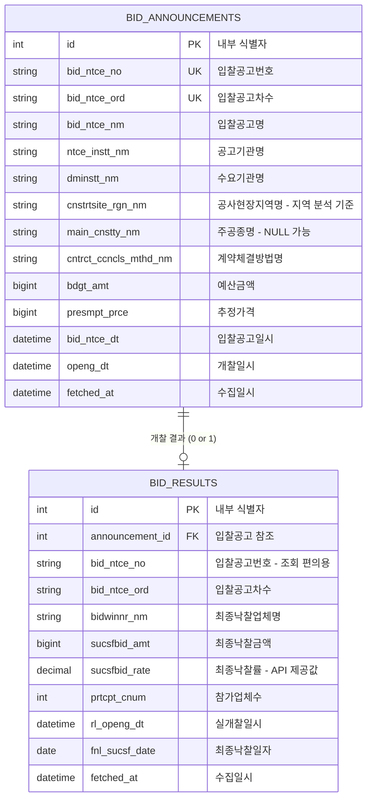

# BidWise — ERD 설계

> 작성일: 2026-09-11
> 대상: 나라장터 공사 입찰 데이터 수집·분석용 DB 스키마

---

## 0. ERD란

**ERD(Entity-Relationship Diagram)** = "이 서비스에 어떤 정보 덩어리가 있고, 서로 어떻게 연결되는지"를 그린 설계도.

집 구조도에 비유하면:

| ERD 용어 | 집 비유 | BidWise에서는 |
|---|---|---|
| **Entity** (엔티티) | 방 | 입찰공고, 낙찰결과 |
| **Attribute** (속성) | 방 안의 물건 | 공고명, 낙찰금액, 지역 등 |
| **Relationship** (관계) | 방과 방 사이의 문 | 공고 ↔ 결과 연결 |
| **Primary Key** (기본키) | 방마다 붙은 고유 호실 번호 | id |
| **Foreign Key** (외래키) | 다른 방을 가리키는 표지판 | announcement_id |

---

## 1. Entity 도출

이 프로젝트가 다루는 데이터는 **두 개의 서로 다른 API**에서 온다. 따라서 Entity도 두 개다.

| Entity | 출처 API | 오퍼레이션 | 의미 |
|---|---|---|---|
| `bid_announcements` | 나라장터 입찰공고정보서비스 | `getBidPblancListInfoCnstwk` | "이런 공사가 나왔습니다" — 공고 게시글 |
| `bid_results` | 나라장터 낙찰정보서비스 | `getScsbidListSttusCnstwk` | "이 공사, 누가 얼마에 따갔습니다" — 결과 발표문 |

---

## 2. 관계(Relationship) 설계

### 카디널리티: 1 : 0..1

```
입찰공고 하나  ──────  낙찰결과 0개 또는 1개
```

**왜 최대 1개인가**
어제 API 응답을 실제로 확인한 결과, 하나의 `bidNtceNo`(입찰공고번호)에 대해
`bidwinnrNm`(낙찰업체명), `sucsfbidAmt`(낙찰금액), `sucsfbidRate`(낙찰률)가
**각각 하나씩만** 존재했다. 경쟁을 거쳐 최종적으로 한 업체가 공사를 따가는 구조이므로 당연한 결과.

**왜 0개일 수도 있는가**
두 API는 완전히 별개로 호출된다. 아래 경우 낙찰정보 API에 해당 공고번호로 조회해도
**레코드 자체가 존재하지 않는다** (필드가 null인 게 아니라, 행이 없음):

- 아직 개찰일(`openg_dt`)이 지나지 않아 결과가 안 나온 공고
- 유찰된 공고 (참여 업체가 없거나 자격 미달로 낙찰자 미결정)

> 비유: 입찰공고 = "시험 접수 명단", 낙찰결과 = "합격자 발표 명단".
> 접수한 사람이 모두 합격자 명단에 오르는 건 아니다.
> 아직 발표 전일 수도, 시험이 무산됐을 수도 있다.

**설계에 미치는 영향**
- 두 테이블을 조회할 때는 `INNER JOIN`이 아니라 **`LEFT JOIN`**을 써야 공고 전체를 볼 수 있다.
- "전체 공고 수"와 "낙찰률을 계산할 수 있는 공고 수"가 다르다 → 대시보드에서 이 둘을 구분해 표시해야 함.

### 재입찰/재공고 처리

`bid_ntce_ord`(입찰공고차수)라는 필드가 있다. 같은 공고가 유찰되어 재공고되면 이 값이 증가한다
(`000` → `001` → ...). 따라서 **공고를 유일하게 식별하는 값은 `bid_ntce_no` 단독이 아니라
`(bid_ntce_no, bid_ntce_ord)` 조합**이다.

---

## 3. ERD 다이어그램



---

## 4. 테이블 상세

### 4.1 `bid_announcements` (입찰공고)

| 컬럼 | 타입 | NULL | API 원본 필드 | 설명 및 채택 근거 |
|---|---|---|---|---|
| `id` | SERIAL | N | — | 내부 기본키. API 필드를 직접 PK로 쓰지 않고 별도 숫자 PK를 두면, 외래키 참조가 가볍고 나중에 식별 규칙이 바뀌어도 안전하다 |
| `bid_ntce_no` | VARCHAR(40) | N | `bidNtceNo` | 입찰공고번호. 두 테이블을 잇는 논리적 연결 키. 예: `R26BK01698381` |
| `bid_ntce_ord` | VARCHAR(3) | N | `bidNtceOrd` | 입찰공고차수. 재공고 시 증가. 기본값 `000` |
| `bid_ntce_nm` | VARCHAR(1000) | N | `bidNtceNm` | 공고명. `main_cnstty_nm`이 비었을 때 **키워드 분류의 폴백 소스**로 쓰인다 |
| `ntce_instt_nm` | VARCHAR(400) | Y | `ntceInsttNm` | 공고기관명 (공고를 낸 기관) |
| `dminstt_nm` | VARCHAR(400) | Y | `dminsttNm` | 수요기관명 (실제 발주한 기관). 확장 기능인 "발주기관별 통계"에 사용 |
| `cnstrtsite_rgn_nm` | VARCHAR(200) | Y | `cnstrtsiteRgnNm` | **공사현장지역명**. 지역별 분석의 기준 필드 (아래 설계 노트 참고) |
| `main_cnstty_nm` | VARCHAR(300) | **Y** | `mainCnsttyNm` | **주공종명**. 공사 종류 분류의 1차 소스. 수의계약 건에서는 비어있음이 실측으로 확인됨 |
| `cntrct_ccncls_mthd_nm` | VARCHAR(500) | Y | `cntrctCnclsMthdNm` | 계약체결방법명 (일반경쟁/제한경쟁/지명경쟁/수의계약). `main_cnstty_nm`이 비는 이유를 설명하는 필드이자, 필터 조건으로도 유용 |
| `bdgt_amt` | BIGINT | Y | `bdgtAmt` | 예산금액(원). 금액대 필터에 사용 |
| `presmpt_prce` | BIGINT | Y | `presmptPrce` | 추정가격(원). 부가세·수수료 제외 금액 |
| `bid_ntce_dt` | TIMESTAMP | Y | `bidNtceDt` | 입찰공고일시. 기간 필터 및 시계열 분석 기준 |
| `openg_dt` | TIMESTAMP | Y | `opengDt` | 개찰일시. 이 시점이 지나야 낙찰결과가 생긴다 |
| `fetched_at` | TIMESTAMP | N | — | 수집 메타데이터. 언제 이 레코드를 API에서 가져왔는지 기록 |
| `region_normalized` | VARCHAR(20) | Y | — | **M2 추가.** 시/도 짧은 이름(`서울`, `전남광주` …, 16개). `cnstrtsite_rgn_nm` 첫 단어에서 계산 |
| `category` | VARCHAR(20) | Y | — | **M2 추가.** 공종 대분류 11개 중 하나. 분류 못하면 NULL (5.2절) |
| `category_source` | VARCHAR(20) | Y | — | **M2 추가.** `main_cnstty` / `license` / `keyword` / `none` — 분류 출처 |
| `lcns_lmt_nm` | VARCHAR(200) | Y | `lcnsLmtNm` (면허제한정보) | **2026-10-26 추가.** 첫 번째 면허 이름. 업종이 빈 공고의 공종 분류 2차 출처. 별도 오퍼레이션 `getBidPblancListInfoLicenseLimit`에서 온다 |

**제약조건**
- `UNIQUE (bid_ntce_no, bid_ntce_ord)` — 중복 수집 방지의 핵심. 같은 공고를 다시 수집해도 중복 행이 생기지 않는다
- `INDEX (cnstrtsite_rgn_nm)` — 지역별 GROUP BY가 잦으므로 인덱스
- `INDEX (bid_ntce_dt)` — 기간 필터가 잦으므로 인덱스
- `INDEX (region_normalized)` — 지역별 집계·필터 기준 (M2, 마이그레이션 0002)

---

### 4.2 `bid_results` (낙찰결과)

| 컬럼 | 타입 | NULL | API 원본 필드 | 설명 및 채택 근거 |
|---|---|---|---|---|
| `id` | SERIAL | N | — | 내부 기본키 |
| `announcement_id` | INT | N | — | `bid_announcements.id` 참조 외래키. **UNIQUE 제약** — 1:0..1 관계를 DB 차원에서 강제 |
| `bid_ntce_no` | VARCHAR(40) | N | `bidNtceNo` | 조회 편의용 중복 저장. JOIN 없이 공고번호로 바로 찾을 때 유용 |
| `bid_ntce_ord` | VARCHAR(3) | N | `bidNtceOrd` | 입찰공고차수 |
| `bidwinnr_nm` | VARCHAR(200) | Y | `bidwinnrNm` | 최종낙찰업체명 |
| `sucsfbid_amt` | BIGINT | Y | `sucsfbidAmt` | 최종낙찰금액(원) |
| `sucsfbid_rate` | NUMERIC(6,3) | Y | `sucsfbidRate` | **최종낙찰률(%)**. API가 `낙찰금액/예정가격×100`으로 이미 계산해 제공. 예: `90.419` |
| `prtcpt_cnum` | INT | Y | `prtcptCnum` | 참가업체수. "경쟁이 치열할수록 낙찰률이 낮아지는가" 같은 분석에 활용 가능 |
| `rl_openg_dt` | TIMESTAMP | Y | `rlOpengDt` | 실개찰일시 (실제로 개찰이 수행된 시각) |
| `fnl_sucsf_date` | DATE | Y | `fnlSucsfDate` | 최종낙찰일자 |
| `fetched_at` | TIMESTAMP | N | — | 수집 메타데이터 |

**타입 선택 노트**
- `sucsfbid_rate`는 `FLOAT`이 아니라 **`NUMERIC(6,3)`** 을 쓴다. 부동소수점은 미세한 오차가 누적되는데, 낙찰률은 평균·집계 연산의 핵심 지표이므로 정확도가 중요하다. `NUMERIC`은 십진수를 정확히 저장한다. (`999.999`까지 표현 가능)
- 금액은 `INTEGER`가 아니라 **`BIGINT`**. `INTEGER` 최대값이 약 21억인데, 수백억 원대 공사가 존재하므로 넘칠 수 있다.

---

## 5. 설계 노트 — 실측으로 확정한 결정들

### 5.1 지역 필드: `cnstrtsiteRgnNm` 채택

**초기 계획**: `dminsttNm`(수요기관명)에서 앞부분을 파싱해 지역 추출
→ 예: `"전북특별자치도 무주군"` → `"전북"`

**변경 이유**: API 응답을 실제로 확인하니 `cnstrtsiteRgnNm`(공사현장지역명)이라는
**전용 필드**가 존재했다. 수의계약 건에도 채워져 있는 것을 확인.

**더 정확한 이유**: 수요기관 소재지와 실제 공사 현장은 다를 수 있다.
(예: 조달청이 발주하지만 공사는 강원도에서 진행) 지역별 낙찰 경향을 보려는 목적에는
**공사가 실제로 벌어지는 위치**가 맞다.

> 여전히 정규화는 필요하다. `"서울특별시 노원구"` → `"서울"` 같은 시/도 단위 축약.

### 5.2 공사종류 분류: 2단계 폴백 전략

`main_cnstty_nm`을 **nullable로 설계한 이유**는 실측 결과 때문이다.

| 확인한 건 | 계약체결방법 | `mainCnsttyNm` |
|---|---|---|
| 무주 반디나래 지원센터 소방공사 | 수의계약 | (비어있음) |
| 고용노동부 전산랙 패치코드 정비공사 | 수의계약 | (비어있음) |
| 노원구 서울둘레길 조성사업 | 제한경쟁 | `산림사업법인(숲길 조성,관리)` |

**원인**: `mainCnsttyNm`은 **적격심사**용 필드다. 적격심사를 거치는 경쟁입찰(일반경쟁/제한경쟁)
에만 채워지고, 수의계약처럼 심사를 생략하는 계약방식에서는 비어있다.

> 2026-10-26 하루치 571건으로 다시 세어 보니 경향일 뿐 규칙은 아니었다 (수의계약인데 채워진 건, 경쟁인데 빈 건이 있음).
> 그래서 분류는 계약방법이 아니라 **값이 있는지만** 본다. 수치는 [DEVLOG 2026-10-26](../DEVLOG.md) 참고.

**대응 전략**:
```
1차: main_cnstty_nm 값이 있으면 그대로 사용 (정확도 높음)
2차: 비어있으면 bid_ntce_nm(공고명)에서 키워드 추출해 분류
     예) "소방공사" → 소방설비 / "둘레길 조성" → 조경
```

> 분류 결과를 별도 컬럼(`cnstty_category` 등)으로 저장할지, 조회 시점에 계산할지는
> 아직 미결정. 수집 시점에 저장해두면 조회가 빠르지만, 분류 규칙을 고칠 때마다
> 전체 데이터를 다시 처리해야 한다.
>
> → 2026-10-26 구현: `category`·`category_source` 컬럼에 저장하고, 규칙을 고치면 `python -m app.reclassify`로 다시 처리한다.
> `main_cnstty_nm`은 실제로는 **면허 업종 47종**이라 "그대로 사용"하지 않고 **대분류 11개**
> (건축·토목·전기·통신·기계설비·소방·조경·산림·환경·국가유산·기타)로 묶는다. 키워드 추정도 같은 11개 중 하나를 고른다.
> 규칙과 정확도(79.3%)는 `backend/app/transformer/category.py`와 DEVLOG 2026-10-26 참고.
>
> → 2026-10-26 같은 날 보강: 업종이 빈 공고도 **면허제한정보**에는 면허(업종 이름)가 있다. 키워드보다 먼저 본다.
> 최종 순서: **업종 → 면허 → 공고명 키워드 → 분류 못함** (`source`: `main_cnstty` / `license` / `keyword` / `none`).

### 5.3 낙찰률을 저장만 하고 계산하지 않는 이유

초기 요구사항에는 "낙찰률 = 낙찰가 ÷ 예정가격으로 계산"이라고 적었으나,
낙찰정보 API가 `sucsfbidRate`를 **이미 계산해서 제공**한다는 것을 확인했다.

직접 계산하지 않는 이유:
- API 문서에 계산식이 명시되어 있어 신뢰할 수 있다
- 우리가 가진 `presmpt_prce`는 **추정가격**이지 **예정가격**이 아니다. 둘은 다른 개념이며,
  예정가격은 복수예비가격 추첨 등을 거쳐 결정되므로 API 응답에 직접 나오지 않는다
- 즉 우리가 직접 계산하면 API 값과 다른 숫자가 나올 수 있다 → API 값을 신뢰하는 게 맞다

---

## 6. 미결정 사항

- [x] 공사종류 분류 결과를 컬럼으로 저장할지, 조회 시 계산할지 
      → **결정: 컬럼으로 저장 (`category`, `category_source`), M2에서 추가** (근거: 분류 로직 자체가 M2 작업이라 M0 시점엔 채울 수 없음 — 2026-09-12)
- [x] 지역 정규화 결과(시/도 단위)를 별도 컬럼으로 둘지 
      → **결정: 별도 컬럼(`region_normalized`)으로 둠, M2에서 추가** (근거: `04_api_spec.md` 3.2절 — 매번 문자열 자르면 인덱스 못 씀 — 2026-09-12)
- [ ] 수집 이력 테이블(`fetch_logs`)을 별도로 둘지
- [x] 유찰/재공고 건을 어떻게 취급할지
      → **결정: 정정·재공고는 차수(`bid_ntce_ord`)별로 별개의 공고 행, 같은 공고의 재입찰(`rbidNo`)은 번호가 가장 큰 최종 결과 하나만 저장, 유찰은 결과 행 없음** (근거: 1:0..1 관계 유지, 낙찰정보 행이 `bidClsfcNo`·`rbidNo`로 더 쪼개져 오는 것을 실측 — 2026-10-26, `transformer/result.py`)
