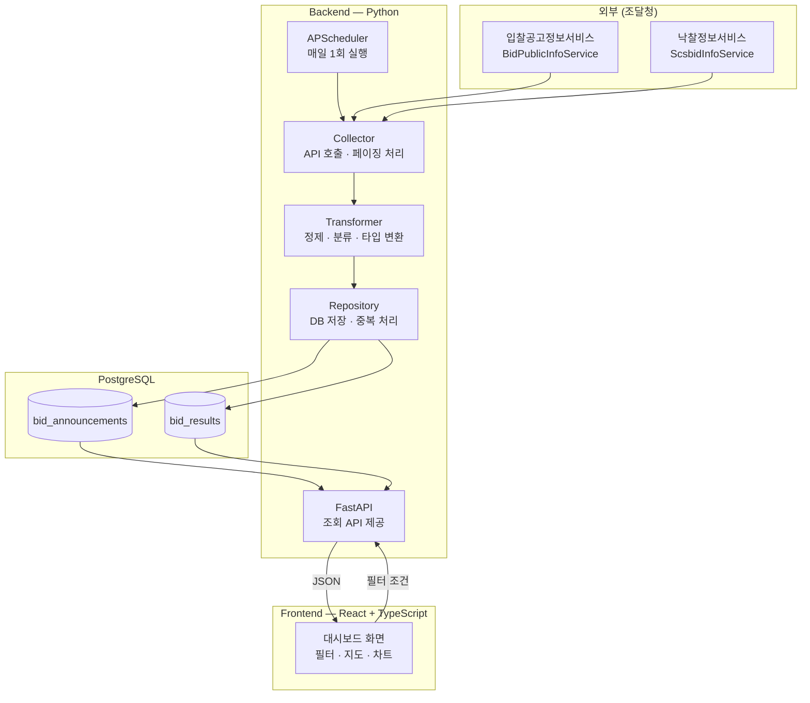
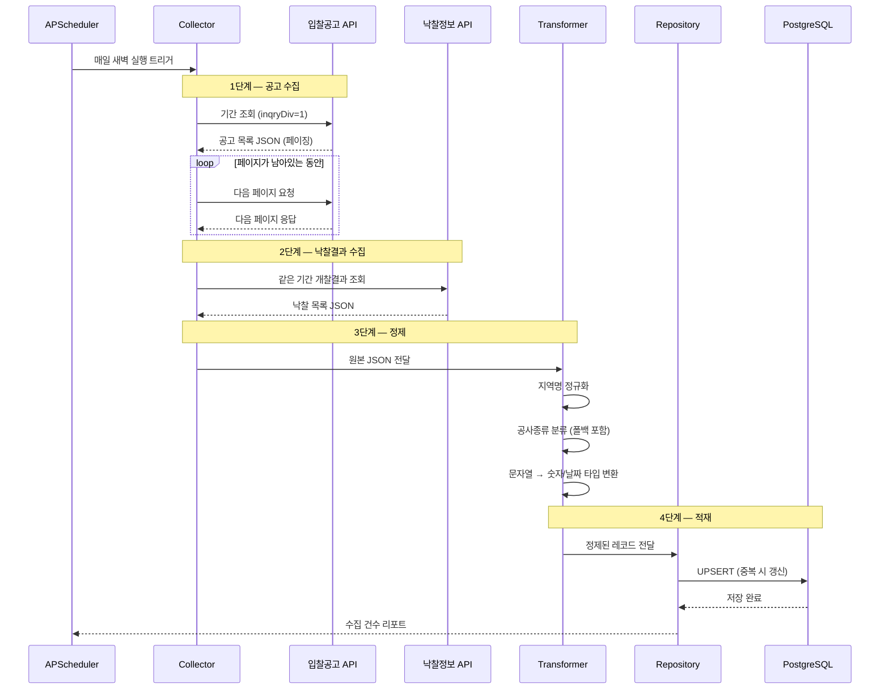
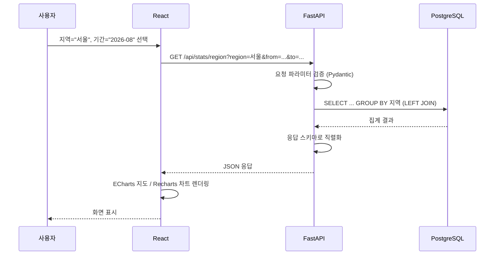

# BidWise — 아키텍처 설계

> 작성일: 2026-09-11
> 선행 문서: `01_requirements.md`, `02_erd.md`

---

## 0. 전체 그림을 한 문장으로

> **나라장터 API에서 데이터를 주기적으로 긁어와 → 정리해서 DB에 쌓아두고 → 사용자가 화면에서 필터를 걸면 → 쌓아둔 데이터를 집계해 차트로 보여준다.**

### 음식점 비유

이 프로젝트 전체를 음식점에 비유하면 이렇다.

| 구성요소 | 음식점 비유 | 실제 |
|---|---|---|
| 나라장터 API | 농산물 도매시장 | 원재료의 출처 |
| 수집기(Collector) | 새벽에 시장 다녀오는 직원 | 스케줄러가 매일 API 호출 |
| 정제기(Transformer) | 재료 손질하는 주방 보조 | 지역명 정리, 공사종류 분류 |
| PostgreSQL | 냉장 창고 | 손질된 재료 보관 |
| FastAPI | 주방장 | 주문이 들어오면 재료로 요리를 만듦 |
| React | 웨이터 + 홀 | 손님의 주문을 받고 음식을 내어놓음 |

**핵심**: 손님(사용자)이 주문할 때마다 시장(API)에 다녀오지 않는다.
미리 창고(DB)에 재료를 쌓아두고, 주문이 오면 창고에서 꺼내 요리한다.
이게 이 아키텍처의 가장 중요한 설계 결정이다. (→ 2장에서 자세히)

---

## 1. 시스템 구성도



---

## 2. 핵심 설계 결정 — 왜 DB에 미리 쌓아두는가

### 대안 A: 사용자가 조회할 때마다 API 호출 (채택 안 함)

```
사용자가 "서울 지역 낙찰률 보여줘" 클릭
  → 그 자리에서 나라장터 API 호출
  → 받은 데이터를 즉석에서 집계
  → 화면에 표시
```

**문제점**
1. **트래픽 한도**: 개발계정은 하루 1,000건 호출 제한. 사용자가 필터를 몇 번만 바꿔도 금방 소진된다
2. **속도**: 외부 API 응답에 평균 500ms + 페이징까지 하면 수 초 걸린다
3. **집계 불가**: "지역별 평균 낙찰률"을 구하려면 전체 데이터가 필요한데, API는 페이지 단위로만 준다
4. **장애 전파**: 나라장터가 점검 중이면 우리 서비스도 통째로 멈춘다

### 대안 B: 미리 수집해 DB에 저장 (채택)

```
[매일 새벽] 스케줄러가 API 호출 → 정제 → DB 저장
[사용자 조회] DB에 SQL 질의 → 즉시 응답
```

**장점**
1. API 호출 횟수가 사용자 수와 무관하게 일정 (하루 수십 건)
2. 조회 응답이 수십 ms 수준
3. `GROUP BY`로 집계가 자유롭다 — 이게 이 프로젝트의 본질이다
4. 나라장터가 멈춰도 이미 쌓인 데이터로 서비스는 계속 동작

> 이 패턴을 일반적으로 **ETL**(Extract 추출 → Transform 변환 → Load 적재)이라 부른다.
> 데이터 분석 시스템의 기본 골격이며, 실무에서 널리 쓰인다.

---

## 3. 데이터 수집 파이프라인 (ETL)



### 각 단계의 책임

| 단계 | 모듈 | 책임 | 하지 않는 일 |
|---|---|---|---|
| Extract | `Collector` | API 호출, 페이징, 재시도, 원본 JSON 반환 | 데이터 해석·가공 |
| Transform | `Transformer` | 정제, 분류, 타입 변환 | API 호출, DB 접근 |
| Load | `Repository` | DB 저장, 중복 처리 | 데이터 가공 |

> **왜 이렇게 나누는가**: 각 모듈이 한 가지 일만 하면, 문제가 생겼을 때 어디를 봐야 하는지 명확해진다.
> "낙찰률이 이상하게 나온다" → Transformer만 보면 된다.
> "데이터가 안 들어온다" → Collector만 보면 된다.
> 테스트도 각각 따로 할 수 있다.

---

## 4. 조회 흐름 (사용자 요청)



### LEFT JOIN을 쓰는 이유

`02_erd.md`에서 정리했듯 입찰공고와 낙찰결과는 **1 : 0..1** 관계다.
개찰 전이거나 유찰된 공고는 `bid_results`에 레코드가 없다.

```sql
-- INNER JOIN을 쓰면: 낙찰된 공고만 나온다 (전체 공고 수를 알 수 없음)
-- LEFT JOIN을 쓰면: 모든 공고가 나오고, 낙찰 안 된 건은 NULL

SELECT
    a.cnstrtsite_rgn_nm          AS 지역,
    COUNT(*)                     AS 전체_공고수,
    COUNT(r.id)                  AS 낙찰완료_건수,
    AVG(r.sucsfbid_rate)         AS 평균낙찰률
FROM bid_announcements a
LEFT JOIN bid_results r ON r.announcement_id = a.id
WHERE a.bid_ntce_dt BETWEEN :from AND :to
GROUP BY a.cnstrtsite_rgn_nm;
```

> `COUNT(*)`는 NULL도 세지만 `COUNT(r.id)`는 NULL을 제외한다.
> 이 차이를 이용해 "전체 공고 수"와 "낙찰 완료 건수"를 한 번에 뽑을 수 있다.
> `AVG()` 역시 NULL을 자동으로 제외하고 평균을 낸다.

---

## 5. 디렉터리 구조 (예정)

```
bidwise/
├── docs/                       # 설계 문서
│   ├── 01_requirements.md
│   ├── 02_erd.md
│   └── 03_architecture.md
│
├── backend/
│   ├── app/
│   │   ├── config.py           # .env 설정 로딩 (2026-10-24 추가)
│   │   ├── models.py           # SQLAlchemy ORM 모델 (ERD 구현체)
│   │   ├── database.py         # DB 연결 · 세션 관리
│   │   ├── schemas.py          # Pydantic 요청/응답 스키마
│   │   │
│   │   ├── collector/          # [Extract] API 호출
│   │   │   ├── client.py       # 나라장터 API 클라이언트
│   │   │   └── scheduler.py    # APScheduler 설정
│   │   │
│   │   ├── transformer/        # [Transform] 정제
│   │   │   ├── region.py       # 지역명 정규화
│   │   │   └── category.py     # 공사종류 분류 (폴백 포함)
│   │   │
│   │   ├── repository/         # [Load] DB 접근
│   │   │   └── bid_repo.py     # 저장 · 중복 처리 · 집계 쿼리
│   │   │
│   │   └── api/                # FastAPI 라우터
│   │       ├── stats.py        # 통계 조회 엔드포인트
│   │       └── bids.py         # 공고 목록 조회 엔드포인트
│   │
│   ├── alembic/                # DB 마이그레이션 (2026-10-24 추가)
│   ├── tests/                  # pytest (2026-10-24 추가)
│   ├── main.py                 # FastAPI 진입점
│   ├── requirements.txt
│   └── .env.example
│
└── frontend/
    └── src/
        ├── components/         # 차트 · 지도 · 필터 UI
        ├── hooks/              # API 호출 로직
        ├── types/              # TypeScript 타입 정의
        └── App.tsx
```

### Repository 패턴을 쓰는 이유

`SubLog`에서 이미 써본 패턴이다. **DB 접근 코드를 한 곳에 모으는 것**이 핵심.

```
[Repository 없이]
api/stats.py 안에 SQL이 직접 박혀있음
→ 나중에 쿼리를 고치려면 API 파일을 뒤져야 함
→ 같은 쿼리가 여러 파일에 복붙됨

[Repository 사용]
api/stats.py 는 repo.get_region_stats(...) 만 호출
→ SQL은 repository/bid_repo.py 한 곳에만 존재
→ 쿼리 수정이 한 곳에서 끝남
```

> 비유: 창고 관리자를 한 명 두는 것.
> 주방장(API)이 직접 창고에 들어가 뒤지는 게 아니라, "무 3개 주세요"라고 요청하면
> 창고 관리자가 찾아서 건네준다. 창고 정리 방식이 바뀌어도 주방장은 영향받지 않는다.

---

## 6. API 엔드포인트 설계 (초안)

| 메서드 | 경로 | 설명 | 주요 쿼리 파라미터 |
|---|---|---|---|
| GET | `/api/stats/summary` | 대시보드 요약 (전체 공고 수, 평균 낙찰률 등) | `from`, `to` |
| GET | `/api/stats/region` | 지역별 낙찰률 집계 (지도용) | `from`, `to` |
| GET | `/api/stats/category` | 공사종류별 낙찰률 집계 (막대차트용) | `from`, `to`, `region` |
| GET | `/api/bids` | 공고 목록 조회 (확장) | `from`, `to`, `region`, `page` |

> 모든 엔드포인트가 `from`, `to`를 공통으로 받는다.
> 기간 필터가 모든 화면의 기본 조건이기 때문.

---

## 7. 이 아키텍처가 감당하지 못하는 것 (한계와 트레이드오프)

솔직하게 적어둔다. 나중에 개선할 때 참고용.

| 한계 | 설명 | 개선 방향 |
|---|---|---|
| **실시간성 없음** | 하루 1회 수집이므로 오늘 올라온 공고는 내일에야 보인다 | 수집 주기를 시간 단위로 줄이거나, 최근 공고만 온디맨드 조회 |
| **집계 쿼리 부하** | 데이터가 수십만 건 쌓이면 매번 `GROUP BY`가 느려질 수 있다 | 집계 결과를 미리 계산해 저장하는 요약 테이블 도입 |
| **수집 실패 추적 어려움** | 현재는 `fetched_at`만 있어 "어제 수집이 실패했는지" 알기 어렵다 | 별도 `fetch_logs` 테이블 (미결정 사항) |
| **분류 규칙 변경 시 재처리** | 공사종류를 저장해두면, 규칙을 고칠 때 전체 데이터를 다시 분류해야 한다 | 재분류 배치 스크립트를 따로 준비 |

---

## 8. 미결정 사항

- [ ] 수집 주기를 정확히 언제로 할지 (나라장터 데이터 갱신 시점 확인 필요)
- [ ] 초기 적재 시 과거 몇 년치를 가져올지 (트래픽 한도 1,000건/일 고려한 분할 수집 계획 필요)
- [ ] 공사종류 분류 결과를 컬럼으로 저장할지, 조회 시 계산할지 (`02_erd.md` 미결정 사항과 동일)
- [ ] 프론트엔드 상태관리 도구를 쓸지 (React 기본 훅만으로 충분한지)
- [ ] 배포 여부 및 환경
