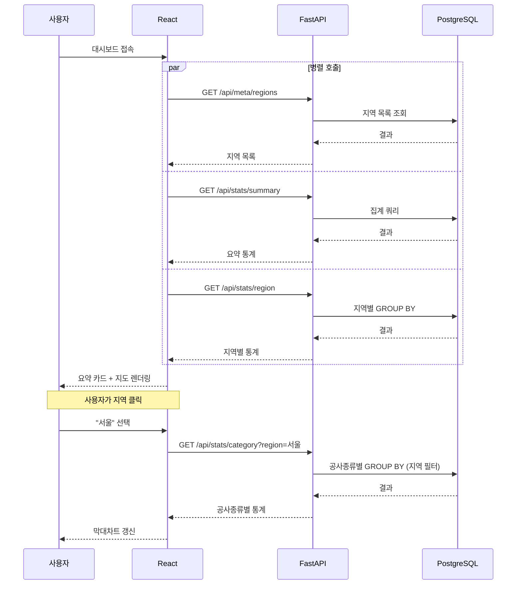

# BidWise — API 명세

> 작성일: 2026-09-11
> 선행 문서: `01_requirements.md`, `02_erd.md`, `03_architecture.md`

---

## 0. 이 문서의 역할

API 명세는 **백엔드와 프론트엔드 사이의 계약서**다.

> 비유: 음식점의 메뉴판.
> 손님(프론트엔드)은 메뉴판만 보고 "3번 시킬게요"라고 주문하면 되고,
> 주방(백엔드)은 메뉴판에 적힌 대로만 만들어내면 된다.
> 서로 주방에 들어가 볼 필요도, 홀에 나가볼 필요도 없다.

이 문서가 확정되면 백엔드와 프론트엔드를 **동시에 따로 개발할 수 있다.**
프론트엔드는 실제 API가 완성되기 전에도 이 명세대로 가짜 데이터(mock)를 만들어 작업할 수 있다.

---

## 1. 공통 규약

### 1.1 기본 정보

| 항목 | 값 |
|---|---|
| Base URL (개발) | `http://localhost:8000` |
| 응답 형식 | `application/json` |
| 문자 인코딩 | UTF-8 |
| 인증 | 없음 (MVP 단계 — 로그인 기능 없음) |

### 1.2 공통 쿼리 파라미터

대부분의 조회 엔드포인트가 공유하는 파라미터.

| 이름 | 타입 | 필수 | 기본값 | 설명 |
|---|---|---|---|---|
| `from` | string (YYYY-MM-DD) | N | 90일 전 | 조회 시작일. `bid_ntce_dt` 기준 |
| `to` | string (YYYY-MM-DD) | N | 오늘 | 조회 종료일 |
| `region` | string | N | 전체 | 시/도 단위 지역명. 예: `서울`, `경기` |

> **왜 기본값을 두는가**: 파라미터 없이 호출해도 동작해야 프론트엔드 초기 로딩이 단순해진다.
> 기본 90일로 잡은 이유는 너무 짧으면 데이터가 빈약하고, 너무 길면 집계가 느려지기 때문.

### 1.3 날짜 형식 규칙

| 위치 | 형식 | 예시 |
|---|---|---|
| 요청 파라미터 | `YYYY-MM-DD` | `2026-08-01` |
| 응답 (날짜) | `YYYY-MM-DD` | `2026-09-01` |
| 응답 (일시) | ISO 8601 | `2026-09-01T11:00:00` |

> 나라장터 API는 `YYYYMMDDHHMM`(요청) / `YYYY-MM-DD HH:MM:SS`(응답)이라는 제각각인 형식을 쓴다.
> **우리 API는 표준 형식으로 통일**하고, 변환 책임은 백엔드가 진다.
> 프론트엔드가 외부 API의 특이한 형식까지 알 필요는 없다.

### 1.4 공통 에러 응답

```json
{
  "detail": "에러 메시지"
}
```

| HTTP 상태 | 발생 조건 |
|---|---|
| `200` | 정상 |
| `422` | 파라미터 형식 오류 (FastAPI/Pydantic이 자동 처리) |
| `500` | 서버 내부 오류 (DB 연결 실패 등) |

> **빈 결과는 에러가 아니다.** 조건에 맞는 데이터가 없으면 `200`과 함께 빈 배열 `[]`을 반환한다.
> `404`를 쓰지 않는 이유: "그런 경로가 없다"와 "데이터가 없다"는 다른 의미이기 때문.

---

## 2. 엔드포인트 목록

| # | 메서드 | 경로 | 용도 | 화면 |
|---|---|---|---|---|
| 1 | GET | `/api/stats/summary` | 대시보드 요약 카드 | 메인 상단 |
| 2 | GET | `/api/stats/region` | 지역별 낙찰률 | 지도 |
| 3 | GET | `/api/stats/category` | 공사종류별 낙찰률 | 막대차트 |
| 4 | GET | `/api/bids` | 공고 목록 (지도 드릴다운) | 리스트 |
| 5 | GET | `/api/meta/regions` | 지역 목록 (필터 옵션용) | 필터 드롭다운 |
| 6 | GET | `/health` | 서버 상태 확인 | — |

---

## 3. 엔드포인트 상세

### 3.1 `GET /api/stats/summary` — 대시보드 요약

메인 화면 상단의 요약 카드에 표시할 전체 통계.

**요청**

```
GET /api/stats/summary?from=2026-06-01&to=2026-09-11
```

| 파라미터 | 타입 | 필수 | 설명 |
|---|---|---|---|
| `from` | date | N | 조회 시작일 |
| `to` | date | N | 조회 종료일 |
| `region` | string | N | 지역 필터 |

**응답**

```json
{
  "period": {
    "from": "2026-06-01",
    "to": "2026-09-11"
  },
  "total_announcements": 12847,
  "completed_count": 9302,
  "pending_count": 3545,
  "avg_sucsfbid_rate": 87.42,
  "total_budget_amt": 4283910000000
}
```

| 필드 | 타입 | 설명 |
|---|---|---|
| `period` | object | 실제 적용된 조회 기간 (기본값이 적용됐을 때 프론트가 알 수 있도록) |
| `total_announcements` | int | 전체 공고 수 |
| `completed_count` | int | 개찰 완료(낙찰결과 존재) 건수 |
| `pending_count` | int | 개찰 전 또는 유찰 건수 |
| `avg_sucsfbid_rate` | float \| null | 평균 낙찰률(%). 완료 건이 하나도 없으면 `null` |
| `total_budget_amt` | int | 예산금액 합계(원) |

> **`completed_count`와 `pending_count`를 나누는 이유**
> `02_erd.md`의 1:0..1 관계 때문이다. 평균 낙찰률은 완료 건만으로 계산되므로,
> "전체 12,847건 중 9,302건 기준으로 낸 평균"이라는 맥락을 화면에 함께 보여줘야 정직하다.

**근거 SQL**

```sql
SELECT
    COUNT(*)                    AS total_announcements,
    COUNT(r.id)                 AS completed_count,
    COUNT(*) - COUNT(r.id)      AS pending_count,
    AVG(r.sucsfbid_rate)        AS avg_sucsfbid_rate,
    COALESCE(SUM(a.bdgt_amt),0) AS total_budget_amt
FROM bid_announcements a
LEFT JOIN bid_results r ON r.announcement_id = a.id
WHERE a.bid_ntce_dt >= :from AND a.bid_ntce_dt < :to;
```

---

### 3.2 `GET /api/stats/region` — 지역별 낙찰률

ECharts 한국 지도(코로플레스)에 사용.

**요청**

```
GET /api/stats/region?from=2026-06-01&to=2026-09-11
```

**응답**

```json
{
  "period": { "from": "2026-06-01", "to": "2026-09-11" },
  "items": [
    {
      "region": "서울",
      "total_count": 1204,
      "completed_count": 892,
      "avg_sucsfbid_rate": 86.91,
      "avg_budget_amt": 342810000
    },
    {
      "region": "경기",
      "total_count": 2317,
      "completed_count": 1740,
      "avg_sucsfbid_rate": 87.55,
      "avg_budget_amt": 289400000
    }
  ]
}
```

| 필드 | 타입 | 설명 |
|---|---|---|
| `region` | string | 시/도 단위 정규화된 지역명 |
| `total_count` | int | 해당 지역 전체 공고 수 |
| `completed_count` | int | 개찰 완료 건수 |
| `avg_sucsfbid_rate` | float \| null | 평균 낙찰률(%) |
| `avg_budget_amt` | int | 평균 예산금액(원) |

**설계 노트**

- 배열을 그냥 반환하지 않고 `{ "period": ..., "items": [...] }`로 감싼 이유:
  나중에 `updated_at`(마지막 수집 시각) 같은 메타데이터를 추가하기 쉽다. 최상위가 배열이면 확장이 막힌다.
- 지역명은 **시/도 단위로 정규화된 값**을 반환한다. `"서울특별시 노원구"`가 아니라 `"서울"`.
  ECharts 지도의 지역 이름과 매칭하려면 통일된 키가 필요하기 때문.
- `avg_sucsfbid_rate`가 `null`인 지역도 배열에 포함한다. 지도에서 "데이터 없음" 색으로 칠해야 하므로.

**근거 SQL**

```sql
SELECT
    a.region_normalized         AS region,
    COUNT(*)                    AS total_count,
    COUNT(r.id)                 AS completed_count,
    AVG(r.sucsfbid_rate)        AS avg_sucsfbid_rate,
    AVG(a.bdgt_amt)             AS avg_budget_amt
FROM bid_announcements a
LEFT JOIN bid_results r ON r.announcement_id = a.id
WHERE a.bid_ntce_dt >= :from AND a.bid_ntce_dt < :to
GROUP BY a.region_normalized
ORDER BY total_count DESC;
```

> (2026-10-26 M2에서 추가됨. 지역은 16개 — 광주·전남은 `전남광주` 하나. 쿼리는 `bid_repo.get_region_stats`)
>
> `region_normalized`는 아직 확정되지 않은 컬럼이다.
> `02_erd.md` 미결정 사항의 "지역 정규화 결과를 별도 컬럼으로 둘지"와 직결된다.
> 이 쿼리를 보면 **별도 컬럼으로 두는 편이 훨씬 낫다**는 게 드러난다.
> 매번 문자열을 잘라 GROUP BY 하면 인덱스를 못 쓰기 때문.

---

### 3.3 `GET /api/stats/category` — 공사종류별 낙찰률

Recharts 막대그래프에 사용.

**요청**

```
GET /api/stats/category?from=2026-06-01&to=2026-09-11&region=서울
```

| 파라미터 | 타입 | 필수 | 설명 |
|---|---|---|---|
| `from` | date | N | 조회 시작일 |
| `to` | date | N | 조회 종료일 |
| `region` | string | N | 특정 지역으로 한정 |
| `limit` | int | N | 상위 N개만 (기본 10) |

**응답**

```json
{
  "period": { "from": "2026-06-01", "to": "2026-09-11" },
  "region": "서울",
  "items": [
    {
      "category": "건축",
      "source": "main_cnstty",
      "total_count": 412,
      "completed_count": 331,
      "avg_sucsfbid_rate": 86.12
    },
    {
      "category": "소방설비",
      "source": "keyword",
      "total_count": 187,
      "completed_count": 140,
      "avg_sucsfbid_rate": 88.04
    },
    {
      "category": "미분류",
      "source": "none",
      "total_count": 93,
      "completed_count": 71,
      "avg_sucsfbid_rate": 89.30
    }
  ]
}
```

| 필드 | 타입 | 설명 |
|---|---|---|
| `category` | string | 공사종류 |
| `source` | string | 분류 출처 — `main_cnstty` / `license` / `keyword` / `none` |
| `total_count` | int | 건수 |
| `completed_count` | int | 개찰 완료 건수 |
| `avg_sucsfbid_rate` | float \| null | 평균 낙찰률(%) |

**`source` 필드를 넣는 이유**

`02_erd.md` 5.2절의 2단계 폴백 전략 때문이다.

| `source` 값 | 의미 | 신뢰도 |
|---|---|---|
| `main_cnstty` | `main_cnstty_nm` 원본값 사용 | 높음 — 조달청이 부여한 공식 분류 |
| `license` | 면허제한정보의 첫 면허 사용 (2026-10-26 추가) | 높음 — 공고서의 면허 조건. 업종과 대분류 96% 일치 |
| `keyword` | 공고명에서 키워드로 추론 | 중간 — 우리가 만든 규칙이라 오분류 가능 |
| `none` | 어느 쪽으로도 분류 실패 | — |

분류 방식에 따라 정확도가 다르므로, **화면에서 이를 구분해 표시할 수 있어야 한다.**
(예: 키워드 추론 항목엔 작은 표시를 달거나, 툴팁으로 "추정 분류"라고 안내)

이 정보를 API가 숨기고 "다 똑같은 분류"인 척하면, 사용자가 데이터를 과신하게 된다.

---

### 3.4 `GET /api/bids` — 공고 목록 (확장 기능)

**요청**

```
GET /api/bids?from=2026-09-01&to=2026-09-11&region=서울&page=1&size=20
```
> 지도에서 지역을 클릭하면 이 엔드포인트가 `region` 파라미터와 함께 호출된다. (지도 → 리스트 드릴다운의 핵심 연결점)

| 파라미터 | 타입 | 필수 | 기본값 | 설명 |
|---|---|---|---|---|
| `from` / `to` / `region` | — | N | — | 공통 파라미터 |
| `category` | string | N | 전체 | 공사종류 필터 |
| `page` | int | N | 1 | 페이지 번호 (1부터) |
| `size` | int | N | 20 | 페이지당 건수 (최대 100) |
| `sort` | string | N | `-bid_ntce_dt` | 정렬. `-` 접두사는 내림차순 |

**응답**

```json
{
  "page": 1,
  "size": 20,
  "total": 1204,
  "items": [
    {
      "bid_ntce_no": "R26BK01706812",
      "bid_ntce_ord": "000",
      "bid_ntce_nm": "2026년 서울둘레길(누리길-수락산) 조성사업",
      "region": "서울",
      "category": "조경",
      "cntrct_ccncls_mthd_nm": "제한경쟁",
      "bdgt_amt": 437908000,
      "presmpt_prce": 261003636,
      "bid_ntce_dt": "2026-09-01T08:19:36",
      "openg_dt": "2026-09-09T11:00:00",
      "result": {
        "bidwinnr_nm": "OO조경건설",
        "sucsfbid_amt": 235400000,
        "sucsfbid_rate": 90.19,
        "prtcpt_cnum": 27
      }
    },
    {
      "bid_ntce_no": "R26BK01706807",
      "bid_ntce_ord": "000",
      "bid_ntce_nm": "고용노동부 TPS실 전산랙 패치코드 정비공사",
      "region": "세종",
      "category": "전기·통신설비",
      "cntrct_ccncls_mthd_nm": "수의계약",
      "bdgt_amt": 62150000,
      "presmpt_prce": 56500000,
      "bid_ntce_dt": "2026-09-01T08:08:21",
      "openg_dt": "2026-09-04T13:00:00",
      "result": null
    }
  ]
}
```

**`result`가 중첩 객체이고 `null`이 가능한 이유**

`02_erd.md`에서 정한 **1 : 0..1 관계를 JSON 구조로 그대로 표현**한 것이다.

```
result: { ... }  → 개찰 완료, 낙찰 정보 있음
result: null     → 개찰 전이거나 유찰됨
```

낙찰 관련 필드를 최상위에 평평하게 펼쳐두고 각각 `null`로 두는 방식도 가능하지만,
그러면 "낙찰 정보 자체가 없는 것"과 "낙찰 정보는 있는데 특정 필드만 비어있는 것"을 구분할 수 없다.
중첩 구조가 데이터의 실제 구조를 더 정직하게 보여준다.

> 프론트엔드에서는 `if (bid.result)` 한 줄로 분기할 수 있어 다루기도 쉽다.

---

### 3.5 `GET /api/meta/regions` — 지역 목록

필터 드롭다운을 채우기 위한 메타 정보.

**응답**

```json
{
  "items": [
    { "code": "11", "name": "서울" },
    { "code": "26", "name": "부산" },
    { "code": "41", "name": "경기" }
  ]
}
```

> **왜 프론트엔드에 하드코딩하지 않는가**
> 행정구역은 실제로 바뀐다. 최근에도 `전북특별자치도`, `강원특별자치도` 같은 변경이 있었고,
> 나라장터 API 변경 이력에도 `전남광주통합특별시 지역코드 추가`가 기록되어 있다.
> 지역 목록을 서버가 관리하면, 바뀌었을 때 백엔드만 고치면 된다.

---

### 3.6 `GET /health` — 상태 확인

```json
{
  "status": "ok",
  "db": "connected",
  "last_fetched_at": "2026-09-11T04:30:00"
}
```

`last_fetched_at`은 가장 최근 수집 시각. 스케줄러가 정상 동작 중인지 확인하는 용도.

---

## 4. 요청 흐름 예시

메인 대시보드 최초 진입 시 프론트엔드가 호출하는 순서.



> **병렬 호출이 가능한 이유**: 세 엔드포인트가 서로 의존하지 않는다.
> 각각 독립적으로 응답하므로 프론트엔드에서 `Promise.all`로 동시에 부를 수 있다.
> 순차 호출하면 3번 기다려야 하지만, 병렬이면 가장 느린 하나만큼만 기다린다.

---

## 5. 네이밍 규칙

| 대상 | 규칙 | 예시 |
|---|---|---|
| URL 경로 | 소문자, 복수형 명사 | `/api/bids`, `/api/stats/region` |
| 쿼리 파라미터 | snake_case | `from`, `to`, `region` |
| 응답 필드 | snake_case | `total_count`, `avg_sucsfbid_rate` |

**응답 필드를 snake_case로 하는 이유**

JavaScript 관습은 camelCase지만, 여기서는 **DB 컬럼명 → API 필드명 변환을 하지 않는 쪽**을 택했다.

- 변환 계층이 하나 줄어 버그 여지가 줄어든다
- 문제가 생겼을 때 API 응답 필드명으로 DB 컬럼을 바로 찾을 수 있다
- 나라장터 원본 필드명(`sucsfbidRate`)과의 대응 관계도 문서에서 추적하기 쉽다

> 다만 프론트엔드 코드 안에서는 camelCase가 자연스러우므로,
> TypeScript 타입 정의 시점에 한 번만 변환하거나, 그대로 snake_case로 쓸지 결정이 필요하다. (미결정)

---

## 6. 미결정 사항

- [x] `region_normalized` 컬럼을 실제로 추가할지 
      → 결정: 추가함, M2에서 (ERD 6장 참고)
- [x] 공사종류 분류 결과도 컬럼으로 저장할지 
      → 결정: 저장함 (`category`, `category_source`), M2에서 (ERD 6장 참고)
- [ ] 프론트엔드에서 snake_case를 그대로 쓸지, camelCase로 변환할지
- [ ] `/api/stats/trend` (시계열 추이) 엔드포인트 — 확장 기능이므로 이번 명세에서는 제외
- [ ] 응답 캐싱 여부 (같은 파라미터의 반복 요청 처리)
- [ ] `/api/stats/category`의 `source`를 어떻게 줄지 — 3.3절 예시는 항목마다 `source` 하나지만, 실제로는 한 대분류 안에 업종 분류와 키워드 추정이 섞인다 (예: 토목 2,842건 중 추정 2,267건, 2026-10-26). 지금 집계 쿼리는 추정 건수(`keyword_count`)를 준다. 항목별 추정 비율로 바꿀지 M4 전에 정한다
