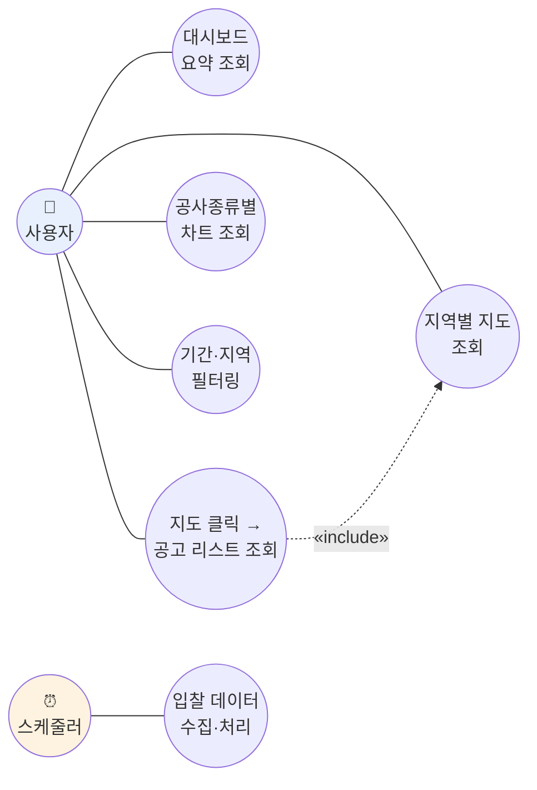
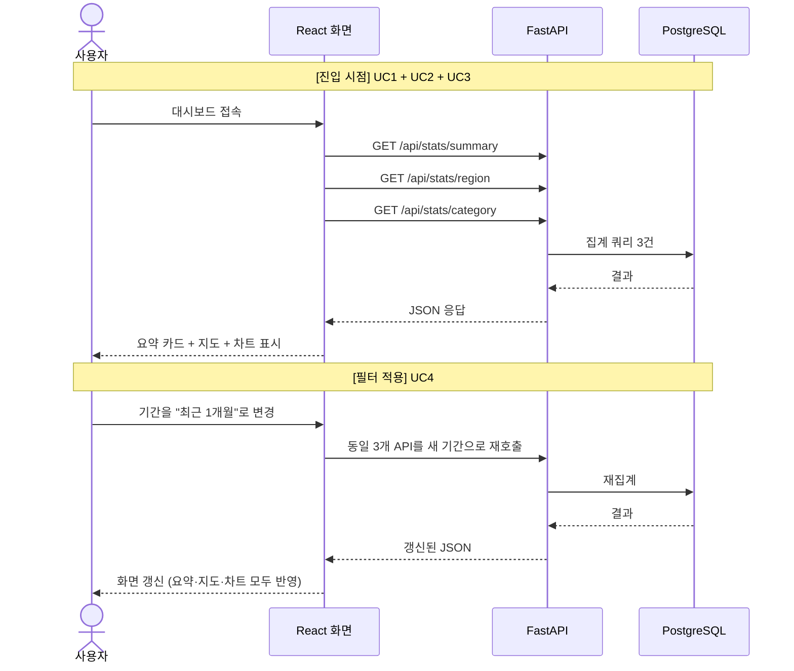
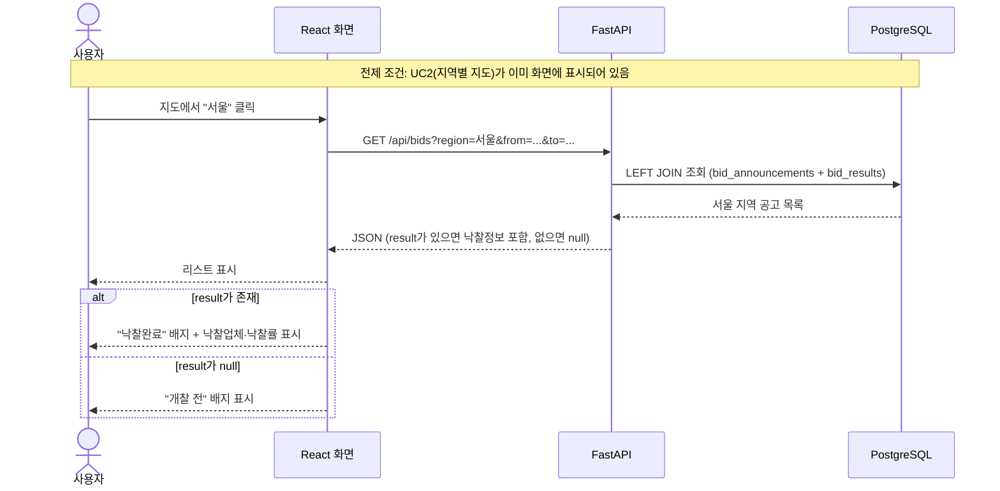
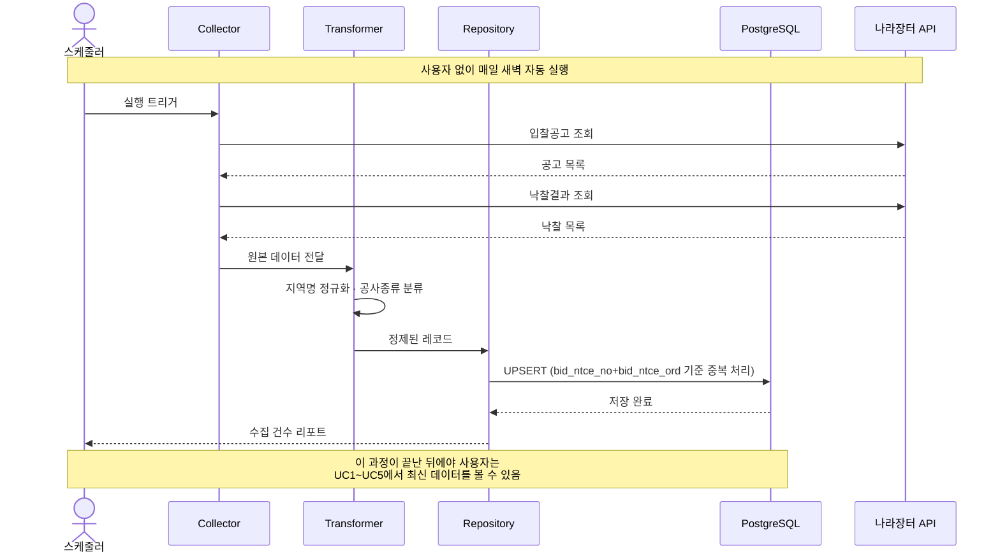

# BidWise — 유즈케이스 & 시퀀스 다이어그램

> 작성일: 2026-09-11
> 선행 문서: `01_requirements.md`, `02_erd.md`, `03_architecture.md`, `04_api_spec.md`

---

## 0. 이 문서가 앞의 문서들과 다른 점

지금까지 만든 문서는 전부 **"시스템 내부에서 어떻게 돌아가는가"**를 다뤘다
(ERD=데이터 구조, Architecture=컴포넌트 흐름, API 명세=요청·응답 규격).

이 문서는 관점을 완전히 바꿔서, **"시스템 밖에서, 누가, 무엇을 위해 이걸 쓰는가"**부터 시작한다.

```
유즈케이스 다이어그램 = 할 수 있는 것들의 전체 지도 (넓고 얕게)
시퀀스 다이어그램     = 그 중 하나가 실제로 일어나는 과정 (좁고 깊게)
```

---

## 1. Actor 정의

| Actor | 유형 | 트리거 방식 |
|---|---|---|
| **사용자** | 사람 | 화면에서 클릭·선택 |
| **스케줄러** | 시스템 | 매일 정해진 시각에 자동 실행 |

**두 Actor로 나눈 이유**: 유즈케이스를 구분하는 기준은 "누가 이 동작을 시작시키는가"다.
사람이 화면 앞에서 시작하는 일과, 시스템이 스스로 시작하는 일은 성격이 다르므로 별개의 Actor로 둔다.

---

## 2. 유즈케이스 다이어그램



### 유즈케이스 목록 정리

| # | 유즈케이스 | Actor | 관련 API | 비고 |
|---|---|---|---|---|
| UC1 | 대시보드 요약 조회 | 사용자 | `GET /api/stats/summary` | 진입 시 최초 표시 |
| UC2 | 지역별 지도 조회 | 사용자 | `GET /api/stats/region` | 낙찰 여부(완료/대기)도 함께 표시 |
| UC3 | 공사종류별 차트 조회 | 사용자 | `GET /api/stats/category` | |
| UC4 | 기간·지역 필터링 | 사용자 | 위 3개 API의 공통 파라미터 | UC1~UC3, UC5에 모두 영향 |
| UC5 | 지도 클릭 → 공고 리스트 조회 | 사용자 | `GET /api/bids?region=...` | UC2를 `«include»` — 지도가 없으면 클릭할 대상 자체가 없음 |
| UC6 | 입찰 데이터 수집·처리 | 스케줄러 | (외부 나라장터 API) | 수집→정제→적재를 하나의 목표로 묶음 |

### `«include»` 관계를 넣은 이유

UC5(지도 클릭 → 리스트)는 UC2(지역별 지도)가 화면에 존재해야만 성립한다.
지도 없이 "클릭해서 리스트 보기"라는 행위 자체가 불가능하기 때문에,
**독립된 유즈케이스가 아니라 UC2에 종속된 확장 동작**으로 표현했다.

> UC6을 4단계(수집/정제/적재)로 쪼개지 않고 하나로 묶은 이유도 같은 논리다.
> 스케줄러 입장에서 이 넷은 항상 함께 일어나는 하나의 목표("데이터를 최신으로 유지하기")이지,
> 개별적으로 의미를 갖는 독립 행위가 아니다.

---

## 3. 차별점 메모 — 왜 "지도"인가

`04_api_spec.md`를 만들고 나서 유사 서비스(모두입찰, 지투비플러스 등)를 조사한 결과,
**실무 입찰 참여 서비스들은 지도 시각화를 제공하지 않는다**는 것을 확인했다.

| | 실무 서비스 (모두입찰 등) | BidWise |
|---|---|---|
| 주 사용자 | 입찰에 실제 참여하려는 업체 | 시장 전체를 조망하려는 학습자 |
| 핵심 질문 | "이 공고에 얼마를 써야 낙찰될까?" | "전국적으로 낙찰 경향이 어떻게 분포하는가?" |
| 제공 형태 | 리스트, 순위표, AI 챗봇, 계산기 | 지도, 집계 차트 |

두 종류의 서비스는 **경쟁 관계가 아니라 목적이 다른 것**이다.
실무 서비스는 개별 의사결정을 돕고, BidWise는 전체 조망을 돕는다.
UC2(지역별 지도 조회)가 이 프로젝트의 정체성을 가장 잘 보여주는 유즈케이스인 이유다.

---

## 4. 시퀀스 다이어그램 — 사용자 여정

`03_architecture.md`의 시퀀스 다이어그램은 **컴포넌트 간 흐름**(Collector→Transformer→Repository)을 그렸다.
여기서는 **유즈케이스 하나를 사용자 여정으로** 다시 그린다. 관점이 다르다.

### 4.1 UC1~UC4 — 대시보드 최초 진입 + 필터링



**설계 포인트**: 필터를 바꾸면 UC1·UC2·UC3에 해당하는 API가 **전부 다시 호출**된다.
필터는 특정 화면 하나가 아니라 대시보드 전체에 영향을 주는 공통 조건이기 때문이다.
(`04_api_spec.md`의 "모든 엔드포인트가 `from`, `to`를 공통으로 받는다"는 결정과 일치)

### 4.2 UC5 — 지도 클릭 → 공고 리스트 조회 (`«include»` UC2)



**설계 포인트**: `alt` 분기가 `02_erd.md`의 1:0..1 관계를 사용자 여정에서 어떻게 체감하게 되는지 보여준다.
같은 화면 안에서 "낙찰완료"와 "개찰 전" 항목이 섞여 나오는 것이 정상 동작이다.

### 4.3 UC6 — 스케줄러에 의한 데이터 수집·처리



**UC1~UC5와의 관계**: 사용자가 보는 모든 화면(UC1~UC5)은 이 UC6이 미리 채워둔 데이터를 조회할 뿐이다.
`03_architecture.md` 2장에서 정리한 "미리 쌓아두고 조회는 빠르게"라는 설계 원칙이
Actor 관점에서 보면 "사용자와 스케줄러는 같은 데이터를 시차를 두고 주고받는 관계"로 요약된다.

---

## 5. 미결정 사항

- [ ] UC5(지도 클릭 → 리스트)에서 목록이 너무 많을 경우 페이지네이션을 어떻게 안내할지 (UI/UX 문서에서 다룰 예정)
- [ ] 필터 변경 시 3개 API를 매번 순차 재호출할지, 디바운스(debounce)를 걸어 과도한 호출을 막을지
