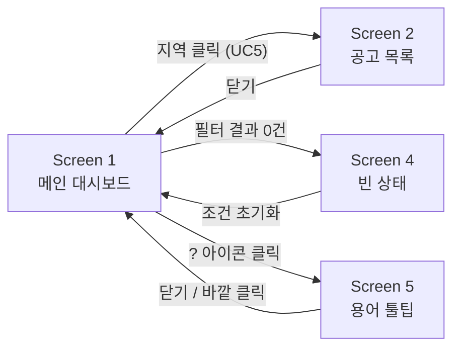

# BidWise — UI/UX 설계

> 작성일: 2026-09-11
> 선행 문서: `01_requirements.md`, `02_erd.md`, `03_architecture.md`, `04_api_spec.md`, `05_usecase_sequence.md`
> Figma 목업: https://www.figma.com/design/1U0pJWd9aJGnNgIOTz4voD/BidWise-%E2%80%94-UI-Mockup

---

## 0. 이 문서의 역할

앞선 문서들이 "무엇을 만들 것인가"(요구사항), "어떻게 저장할 것인가"(ERD),
"어떻게 흐르는가"(아키텍처), "어떻게 주고받는가"(API), "누가 무엇을 하는가"(유즈케이스)를 다뤘다면,
이 문서는 **"실제로 어떻게 보이는가"**를 다룬다.

Figma에서 만든 하이파이 목업을 화면별로 정리하고, 왜 그렇게 그렸는지 근거를 남긴다.
실제 프론트엔드 구현(React + shadcn/ui) 시 이 문서를 참고해 컴포넌트를 매핑한다.

---

## 1. 디자인 방향

### 왜 이런 톤인가

`05_usecase_sequence.md` 3장에서 확인했듯, 실무 입찰 서비스(모두입찰 등)는
텍스트·표 위주의 조밀한 UI를 쓴다. BidWise는 **"시장 전체를 조망하는 학습 도구"**라는
정체성이 다르므로, 여백이 있고 지도가 주인공인 모던한 대시보드 톤을 택했다.

### 컬러 — 건설 도메인에서 근거를 가져옴

일반적인 SaaS 대시보드 팔레트(크림 배경, 세리프 폰트, 테라코타 포인트 같은 뻔한 조합)를
피하고, **주제 자체(공사·도면·청사진)에서 색을 끌어왔다.**

| 토큰 | 값 | 용도 |
|---|---|---|
| `bg/base` | `#12151A` | 콘크리트 그레이 — 화면 배경 |
| `bg/surface` | `#1A1E26` | 카드 배경 |
| `bg/elevated` | `#232833` | 활성/선택 상태 배경 |
| `border/subtle` · `border/strong` | `#2E3440` · `#3D4453` | 구분선 |
| `text/primary` · `secondary` · `muted` | `#E8EBF0` · `#8B94A6` · `#5C6679` | 텍스트 위계 |
| `accent/safety` | `#F2C12E` | 안전모 옐로우 — **정말 눈에 띄어야 할 곳에만** (선택 상태, 핵심 지표) |
| `data/blue-100~900` | `#1B2A40` → `#7CC6FF` | 청사진 블루 스케일 — 지도·차트의 데이터 표현 전용 |
| `status/done` · `status/pending` | `#3DD68C` · `#6B7689` | 낙찰완료 / 개찰 전 |

**강조색을 하나만 쓴 이유**: 노란색이 여러 군데 흩어지면 "뭐가 진짜 중요한지" 신호가 흐려진다.
선택된 지역, 핵심 지표, 액션 버튼처럼 사용자의 시선이 반드시 가야 할 곳에만 예약해뒀다.

### 타이포그래피

**IBM Plex Sans KR 하나만** 사용한다. Pretendard는 이 환경에 없었고, Noto Sans KR보다
숫자 형태가 또렷해 지표 중심 대시보드에 더 잘 맞는다. 폰트를 두 개 섞지 않은 이유는
이 프로젝트 규모에서 위계는 굵기(Light~SemiBold)와 크기만으로 충분히 표현되기 때문이다.

| 역할 | 스펙 | 용도 |
|---|---|---|
| Display | 30 / Light / -2% | 요약 카드의 큰 숫자 |
| H1 | 19 / SemiBold | 화면 제목 |
| H2 | 16 / SemiBold | 카드 제목 |
| Body | 13 / Medium | 리스트 항목 제목 |
| Caption | 11 / Regular | 보조 설명 |

---

## 2. 화면 목록과 유즈케이스 매핑

| 화면 | 대응 유즈케이스 (`05_usecase_sequence.md`) | Figma |
|---|---|---|
| Screen 1 — 메인 대시보드 | UC1, UC2, UC3, UC4 | node-id `1-19` |
| Screen 2 — 지역 선택 → 공고 목록 | UC5 (UC2를 `«include»`) | node-id `4-447` |
| Screen 3 — 토큰 & 컴포넌트 참고 시트 | (구현 참고용, 유즈케이스 아님) | node-id `6-2` |
| Screen 4 — 빈 상태 (결과 0건) | UC4의 예외 경로 | node-id `12-2` |
| Screen 5 — 용어 툴팁 열린 상태 | (신규 — 3장 참고) | node-id `15-2` |

> Figma 링크 형식: 기본 URL 뒤에 `?node-id=<위 코드>`를 붙이면 해당 화면으로 바로 이동한다.
> 예: `.../BidWise-...?node-id=1-19`

---

## 3. Screen 1 — 메인 대시보드

**구성**: 헤더 / 필터바 / 요약 카드 4개 / 지도+랭킹 / 공종별 차트

### 요약 카드 4개가 보여주는 것과 근거

| 카드 | 근거 API 필드 (`04_api_spec.md`) | 설계 포인트 |
|---|---|---|
| 전체 공고 | `total_announcements` | 큰 숫자 아래 "개찰완료 9,302 · 진행중 3,545"로 `completed_count`/`pending_count` 병기 |
| 평균 낙찰률 | `avg_sucsfbid_rate` | 유일하게 강조색(옐로우) 적용 — 이 서비스의 핵심 지표이기 때문 |
| 총 예산 규모 | `total_budget_amt` | "억원" 단위로 변환해 표시 (원 단위 그대로면 자릿수 때문에 안 읽힘) |
| 평균 참가업체 | (확장 — `prtcpt_cnum` 평균) | 서브텍스트로 "경쟁이 치열할수록 낙찰률 하락"이라는 해석을 붙임 |

**"평균 낙찰률" 카드에 서브텍스트로 "개찰완료 9,302건 기준"을 넣은 이유**:
`03_architecture.md`의 LEFT JOIN 설계, `04_api_spec.md`의 `completed_count`/`pending_count` 분리가
사용자에게 드러나는 지점이다. 전체 12,847건이 아니라 완료된 건만으로 낸 평균이라는 걸
화면에서 감추면 통계가 왜곡되어 보일 수 있다.

### 지도 + 랭킹 패널

- 지도는 `avg_sucsfbid_rate`를 5단계 블루 스케일로 코로플레스 표현 (`04_api_spec.md` 3.2절 응답 구조 그대로)
- 우측 랭킹 패널은 같은 데이터를 **막대 형태로 재표현** — 지도는 공간 감각에, 랭킹은 정확한 순서 비교에 강하므로 서로 보완
- 지역 이름 위 툴팁(`? 아이콘`)은 없음 — 지역명은 도메인 용어가 아니라 일반 지명이라 설명이 불필요

### 공종별 차트의 `source` 배지

`04_api_spec.md` 3.3절에서 정의한 `source` 필드(`main_cnstty` / `keyword` / `none`)를
화면에서 배지로 구분했다.

| 배지 | 의미 | 근거 |
|---|---|---|
| (없음) | `mainCnsttyNm` 원본 사용 | 조달청 공식 분류 — 신뢰도 높음 |
| `추정` (옐로우 테두리) | 공고명 키워드로 분류 | `02_erd.md` 5.2절의 폴백 전략 결과 |
| `분류없음` (회색 테두리) | 어느 쪽으로도 분류 실패 | — |

분류 방식이 다른 데이터를 똑같은 얼굴로 보여주면 사용자가 정확도를 과신하게 되므로,
API가 이미 구분해서 주는 정보를 화면에서도 숨기지 않았다.

---

## 4. Screen 2 — 지역 선택 → 공고 목록

**전제**: `05_usecase_sequence.md` 4.2절 시퀀스를 그대로 화면으로 옮긴 것.

### 지도 상태 변화

- 선택된 지역: 옐로우 테두리(3px)로 강조
- 나머지 지역: `opacity: 0.3`으로 흐림 처리
- 지역 필터 셀렉트도 동시에 활성 상태(옐로우 테두리)로 동기화

**"흐림 처리"를 택하고 완전히 숨기지 않은 이유**: 사용자가 지도 위에서 자신의 위치 감각을
잃지 않아야 한다. 선택 안 된 지역을 아예 지우면 "전국 중 이 지역"이라는 맥락이 끊긴다.

### 공고 카드의 3가지 상태

`02_erd.md`의 1:0..1 관계(`bid_announcements` ↔ `bid_results`)가 화면에서 드러나는 지점.

| 상태 | 조건 (`04_api_spec.md` 3.4절 기준) | 화면 표현 |
|---|---|---|
| 낙찰완료 | `result` 객체 존재 | 초록 배지 + 낙찰률(파란 강조 숫자) + 참가업체 수 |
| 개찰 전 | `result: null` | 회색 배지 + "OO 개찰 예정" 날짜 표시 |
| 선택됨 | (프론트 로컬 상태) | 옐로우 테두리 2px + 배경 한 단계 밝게 |

같은 리스트 안에 "낙찰완료"와 "개찰 전" 카드가 섞여 나오는 것이 정상 동작이며,
이는 버그가 아니라 ERD에서 이미 예견하고 설계한 데이터 구조다.

---

## 5. Screen 4 — 빈 상태

### 왜 만들었나

`04_api_spec.md` 1.4절에서 "빈 결과는 에러가 아니다, 200과 함께 빈 배열을 반환한다"고
명시했다. 설계 문서에서 다룬 케이스는 화면에서도 최소 한 번은 그려보는 것이 문서 간 일관성을 지킨다.

### 설계 원칙 — "무슨 일 / 왜 / 뭘 하면 되는지"

빈 화면만 보여주면 사용자는 오류로 오인한다. 세 가지를 반드시 함께 보여준다.

1. **무슨 일** — "조건에 맞는 공고가 없습니다"
2. **왜** — "제주 지역의 철도·궤도 일반경쟁 공고는 최근 1개월간 등록되지 않았습니다" (실제로 걸려 있는 필터 조건을 구체적으로 되짚어줌)
3. **뭘 하면 되는지** — "기간 넓혀보기" / "조건 초기화" 액션 버튼

### 결정 사항 — 액션 버튼 문구는 "제안"이지 "보장"이 아니다

처음에는 "기간 1년으로 넓히기"라는 확정적 문구를 썼으나, 이 버튼을 눌러도
결과가 나온다는 보장이 없다는 문제를 논의했다. `04_api_spec.md`에 조건별 결과 수를
미리 계산해 알려주는 기능이 없기 때문이다.

세 가지 대안을 검토했다:

| 안 | 내용 | 채택 여부 |
|---|---|---|
| A | 안전한 "조건 초기화"만 남김 | 사용자 편의성이 떨어짐 |
| B | 버튼은 필터 값만 바꿔주는 제안으로 남기되, 결과를 확정하지 않음 | 여전히 결과가 0건일 수 있음 | 
| C | 백엔드가 조건별 카운트를 미리 계산해 정확히 예고 | MVP 범위를 벗어나는 새 API 필요 |

B안을 택한 이유는 "제안"과 "약속"을 구분하면 정직성 문제가 해소되기 때문이다.
실제 서비스들(검색엔진의 "다른 검색어를 시도해보세요" 등)도 이 방식을 쓴다.

---

## 6. Screen 5 — 용어 툴팁 (신규 기능)

### 왜 필요한가

`05_usecase_sequence.md` 3장에서 정의한 BidWise의 정체성은 "이 분야를 모르는 학습자를 위한 조망 도구"다.
그런데 화면에는 적산·낙찰률·주공종·수의계약 같은 도메인 용어가 그대로 노출된다.
목표 사용자층과 화면의 언어 수준이 어긋나는 지점이었다.

### 형태 선택 — Tooltip이 아니라 Popover

| | Tooltip | **Popover (채택)** |
|---|---|---|
| 트리거 | 마우스 호버 | 클릭 |
| 유지 방식 | 마우스가 벗어나면 즉시 닫힘 | 바깥을 클릭할 때까지 유지 |
| 터치 기기 | 동작 안 함 (호버 자체가 없음) | 정상 동작 |
| 적합한 내용 길이 | 한두 단어 | 여러 줄 설명 |

용어 설명은 정의+공식+비유+출처까지 4~5줄이 필요해 Tooltip으로는 읽는 도중 닫혀버린다.
Popover로 채택해 사용자가 자기 속도로 읽고 원할 때 닫도록 했다.

### 설명 구조 — 4단계 고정 포맷

모든 용어 설명은 같은 구조를 따른다 (일관성 있는 학습 경험을 위해):

1. **한 줄 정의** — 전문 용어 없이 풀어쓴 한 문장
2. **공식/기준** (해당하는 경우) — 원본 계산식을 있는 그대로 표기
3. **"쉽게 말하면"** — 실생활 비유. 왼쪽에 옐로우 바로 시각적으로 구분
4. **출처** — API 원본 필드명 표기 (예: `sucsfbidRate`) — 어디서 온 값인지 투명하게 밝힘

### 용어 사전 (Screen 3에 전체 수록)

| 용어 | API 필드 |
|---|---|
| 낙찰률 | `sucsfbidRate` |
| 예정가격 | (API 직접 미제공 — 개념 설명만) |
| 추정가격 | `presmptPrce` |
| 공종(주공종) | `mainCnsttyNm` |
| 수의계약 | `cntrctCnclsMthdNm` |
| 제한·일반경쟁 | `cntrctCnclsMthdNm` |
| 개찰 | `opengDt` |
| 유찰 | — |

**"예정가격"과 "추정가격"을 별도 항목으로 나눈 이유**: `02_erd.md` 5.3절에서 이미 짚었던
혼동 지점이다. 개발자(본인)조차 처음에 헷갈렸던 개념이므로, 사용자도 헷갈릴 것이 분명해
반드시 구분해 사전에 남겼다.

### 적용 대상 (Screen 1 기준)

물음표 아이콘은 다음 4곳에만 붙였다: 평균 낙찰률, 평균 참가업체, 공종별 평균 낙찰률, 계약방법 필터.
지역명처럼 일반 상식으로 이해되는 용어에는 붙이지 않았다 — 아이콘이 남발되면
"정말 낯선 용어가 어디인지" 신호가 흐려지기 때문이다.

---

## 7. shadcn/ui 컴포넌트 매핑 (구현 참고)

| 화면 요소 | shadcn/ui 컴포넌트 |
|---|---|
| 상단 기간 선택 (세그먼트) | `Tabs` 또는 `ToggleGroup` |
| 지역·공종·계약방법 필터 | `Select` |
| 요약 통계 카드 | `Card` + `CardHeader` / `CardContent` |
| 공고 카드 | `Card` + `Badge` |
| 낙찰완료 / 개찰 전 표시 | `Badge` (`variant="outline"`) |
| 지역 랭킹 막대 | `Progress` |
| 닫기 · 조건 초기화 버튼 | `Button` (`variant="outline"` / `"ghost"`) |
| 용어 설명 | `Popover` (Tooltip 아님 — 6장 근거 참고) |
| 빈 상태 액션 버튼 | `Button` (`variant="default"` — 유일한 강조색 사용처) |

---

## 8. 미결정 사항

- [ ] 로딩 상태(스켈레톤 UI) — 목업에서 아직 그리지 않음. 실제 API 응답 속도 확인 후 결정
- [ ] 모바일/반응형 레이아웃 — `03_architecture.md` 7장에서 이미 확장 기능으로 분류됨. 데스크탑 1440px 우선 구현
- [ ] 공고 리스트가 길 때(수천 건)의 페이지네이션 방식 — 무한 스크롤 vs 페이지 번호
- [ ] Screen 4 빈 상태의 "기간 넓혀보기" 버튼 클릭 시 실제로 필터만 바꾸고 재조회하는 정확한 인터랙션 명세
- [ ] 용어 팝오버를 모바일(터치)에서 어떻게 트리거할지 — 클릭은 데스크탑과 동일하게 동작할 것으로 예상되나 미검증
