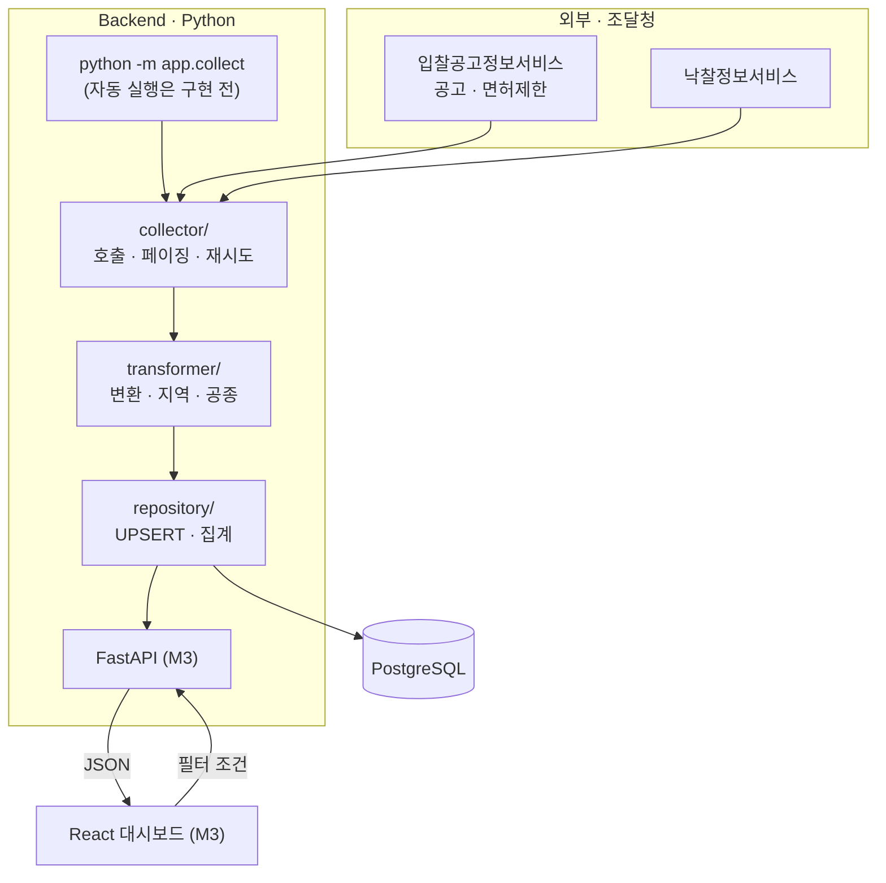
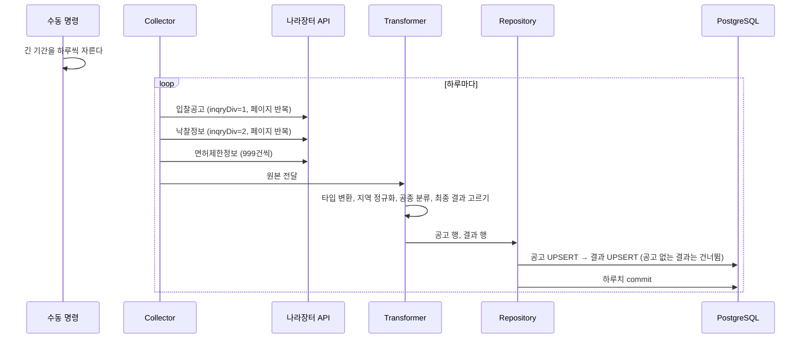
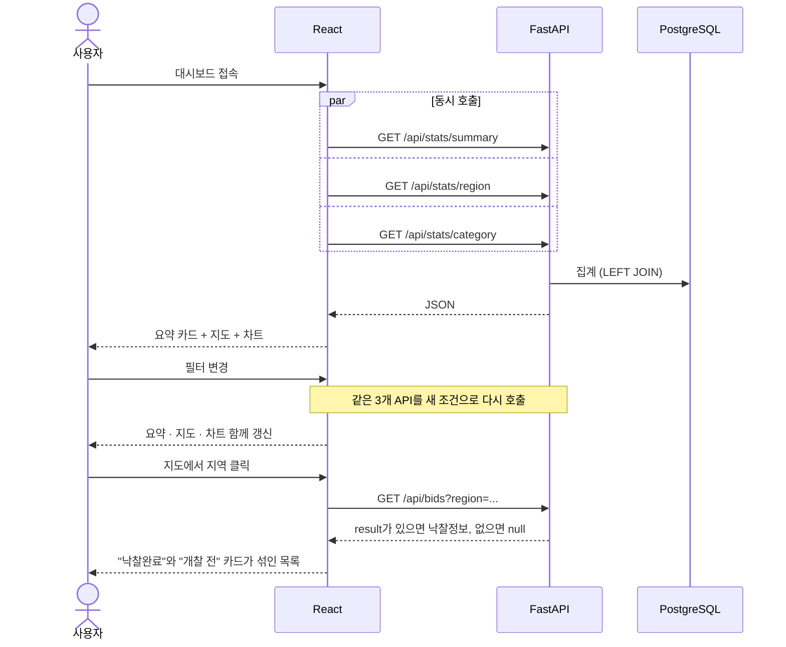

# BidWise — 아키텍처

> **코드가 어떻게 나뉘고 데이터 · 요청이 어떻게 흐르는지, API 계약, 개발 환경을 적는 문서다.**
> 왜 미리 수집하는지는 [0003](decisions/0003-etl-store-first.md), 저장 구조는 [DATA_MODEL](DATA_MODEL.md), 진행 상황은 [PLAN](PLAN.md). 함정과 명령은 [CLAUDE.md](../CLAUDE.md).

---

## 1. 전체 그림

나라장터 API에서 데이터를 가져와 → 정리해서 DB에 쌓아 두고 → 사용자가 필터를 걸면 → 쌓아 둔 데이터를 집계해 보여 준다.

> 비유: 나라장터 = 도매시장, Collector = 새벽 장보기 직원, Transformer = 재료 손질, PostgreSQL = 냉장 창고, Repository = 창고 관리자, FastAPI = 주방장, React = 홀.



---

## 2. 흐름

### 2.1 수집 (구현됨, `app/collect.py`)



- **순서가 중요하다**: 공고를 먼저 넣어야 결과가 붙을 `announcement_id`가 생긴다.
- **하루 단위 commit**: 한 달을 한 번에 받다가 48페이지째 시간 초과로 호출 47번이 버려진 뒤 바꿨다. 실패해도 그날만 다시 돌리면 된다.
- 낙찰결과는 개찰이 끝나야 생기므로 같은 기간을 나중에 다시 돌리면 더 붙는다. UPSERT라 행이 늘지 않는다.

**각 단계가 하지 않는 일**

| 단계 | 책임 | 하지 않는 일 |
|---|---|---|
| Collector | API 호출, 페이징, 재시도, 원본 반환 | 해석 · 가공 |
| Transformer | 변환, 분류 | API 호출, DB 접근 |
| Repository | 저장, 중복 처리, 집계 쿼리 | 가공 |

### 2.2 재분류 · 백필 (구현됨)

- `python -m app.reclassify`: 저장된 공고를 API 호출 없이 다시 분류. 수집과 같은 함수를 쓰고 바뀐 행만 UPDATE한다.
- `python -m app.backfill_license`: 면허제한정보가 생기기 전에 모은 공고에 면허를 채운 뒤 재분류.

### 2.3 자동 수집 (구현 전)

스케줄러는 `collect_by_day`를 부르기만 하면 된다. "어제치"만이 아니라 **지난 몇 주를 다시 수집**해야 경쟁입찰 결과가 채워진다. 어느 마일스톤에 넣을지는 [PLAN](PLAN.md) 5장.

### 2.4 조회 (구현 전, M3 ~ M5)



필터는 대시보드 전체의 공통 조건이라 3개 API를 전부 다시 부른다. 서로 의존하지 않으니 `Promise.all`로 동시에 부른다. 순차면 3번 기다리고, 동시면 가장 느린 하나만큼 기다린다.

---

## 3. API 계약

> **아직 FastAPI 코드가 없어서 이 절이 원본이다.** 구현한 엔드포인트는 Swagger(`/docs`)로 넘기고 3.1 ~ 3.6의 해당 절을 지운다. 3.0의 계약만 남긴다.
> 저장소 쪽에는 `bid_repo.get_summary` · `get_region_stats` · `get_category_stats`가 이미 있다. 라우터 · 스키마는 M3부터. 아래 JSON의 숫자는 모양을 보여 주는 예시다.

### 3.0 공통 규약

| 항목 | 값 |
|---|---|
| Base URL (개발) | `http://localhost:8000` |
| 응답 형식 | `application/json`, UTF-8 |
| 인증 | 없음 |
| 날짜 | 요청 · 응답 `YYYY-MM-DD`, 일시 ISO 8601. 나라장터의 제각각 형식은 백엔드가 변환한다 |
| 네이밍 | URL은 소문자 복수 명사, 필드 · 파라미터는 snake_case |

**공통 쿼리 파라미터**

| 이름 | 기본값 | 설명 |
|---|---|---|
| `from` | 90일 전 | 시작일, `bid_ntce_dt` 기준 |
| `to` | 오늘 | 종료일 (그날 포함, "다음 날 0시 미만"으로 처리) |
| `region` | 전체 | 시/도 짧은 이름. 예: `서울`, `전남광주` |

기본값을 두는 이유: 파라미터 없이 불러도 동작해야 프론트 초기 로딩이 단순하다.

**에러**: `{"detail": "메시지"}`. `422` 파라미터 형식 오류(FastAPI 자동), `500` 서버 내부 오류.
**빈 결과는 에러가 아니다.** `200`과 빈 배열. "그런 경로가 없다"와 "데이터가 없다"는 다르므로 `404`를 쓰지 않는다.

**필드가 snake_case인 이유**: DB 컬럼명 → API 필드명 변환 계층을 두지 않아 버그 여지가 줄고, 응답 필드로 컬럼을 바로 찾을 수 있다.

**배열을 그대로 주지 않고 `{ "period": ..., "items": [...] }`로 감싸는 이유**: 나중에 메타데이터를 더하기 쉽다. 최상위가 배열이면 확장이 막힌다.

| # | 경로 | 용도 |
|---|---|---|
| 3.1 | `GET /api/stats/summary` | 요약 카드 |
| 3.2 | `GET /api/stats/region` | 지도 |
| 3.3 | `GET /api/stats/category` | 막대차트 |
| 3.4 | `GET /api/bids` | 지도 드릴다운 목록 |
| 3.5 | `GET /api/meta/regions` | 필터 드롭다운 |
| 3.6 | `GET /health` | 상태 확인 |

### 3.1 `GET /api/stats/summary`

파라미터: `from`, `to`, `region`.

```json
{
  "period": { "from": "2026-09-26", "to": "2026-10-25" },
  "total_announcements": 10285,
  "completed_count": 5021,
  "pending_count": 5264,
  "avg_sucsfbid_rate": 90.63,
  "total_budget_amt": 4283910000000
}
```

- `period`는 실제 적용된 기간이다. 기본값이 적용됐을 때 프론트가 알 수 있게.
- `pending_count`는 개찰 전 또는 유찰. `avg_sucsfbid_rate`는 완료 건이 없으면 `null`.
- 평균은 완료 건만으로 낸다. "전체 중 몇 건 기준"을 화면에 함께 보여 줘야 정직하므로 두 건수를 나눠 준다.

### 3.2 `GET /api/stats/region`

파라미터: `from`, `to`. 전국 지도라 `region`을 받지 않는다 (`get_region_stats`).

```json
{
  "period": { "from": "2026-09-26", "to": "2026-10-25" },
  "items": [
    { "region": "서울", "total_count": 676, "completed_count": 310, "avg_sucsfbid_rate": 91.69, "avg_budget_amt": 342810000 }
  ]
}
```

- `region`은 시/도 짧은 이름(16개). ECharts 지도와 맞추려면 통일된 키가 필요하다.
- `avg_sucsfbid_rate`가 `null`인 지역도 포함한다. 지도에서 "데이터 없음" 색으로 칠해야 한다.

### 3.3 `GET /api/stats/category`

파라미터: `from`, `to`, `region`, `limit`(상위 N개, 기본 10).

```json
{
  "period": { "from": "2026-09-26", "to": "2026-10-25" },
  "region": null,
  "items": [
    { "category": "건축", "total_count": 3135, "completed_count": 1600, "avg_sucsfbid_rate": 90.1, "keyword_count": 40 },
    { "category": "미분류", "total_count": 132, "completed_count": 60, "avg_sucsfbid_rate": 90.5, "keyword_count": 0 }
  ]
}
```

- `category`는 대분류 11개 또는 `미분류`.
- 한 대분류 안에 업종 · 면허 분류와 키워드 추정이 섞이므로 항목별 `source` 하나로는 표현이 안 된다. 그래서 **추정 건수 `keyword_count`** 를 준다 (`get_category_stats`).

**분류 출처 `category_source`**

| 값 | 의미 | 신뢰도 |
|---|---|---|
| `main_cnstty` | 공고의 업종 사용 | 높음 — 조달청 값 |
| `license` | 면허제한정보의 첫 면허 사용 | 높음 — 업종과 대분류 98.4% 일치 |
| `keyword` | 공고명 키워드로 추정 | 중간 — 우리가 만든 규칙 |
| `none` | 분류 실패 | — |

출처를 숨기고 "다 똑같은 분류"인 척하면 사용자가 데이터를 과신한다.

### 3.4 `GET /api/bids`

파라미터: `from`, `to`, `region`, `category`, `page`(기본 1), `size`(기본 20, 최대 100), `sort`(기본 `-bid_ntce_dt`, `-`는 내림차순). 지도에서 지역을 클릭하면 `region`과 함께 불린다.

```json
{
  "page": 1,
  "size": 20,
  "total": 676,
  "items": [
    {
      "bid_ntce_no": "R26BK01706812",
      "bid_ntce_ord": "000",
      "bid_ntce_nm": "2026년 서울둘레길(누리길-수락산) 조성사업",
      "region": "서울",
      "category": "산림",
      "category_source": "main_cnstty",
      "cntrct_ccncls_mthd_nm": "제한경쟁",
      "bdgt_amt": 437908000,
      "presmpt_prce": 261003636,
      "bid_ntce_dt": "2026-09-01T08:19:36",
      "openg_dt": "2026-09-09T11:00:00",
      "result": {
        "bidwinnr_nm": "OO조경건설",
        "sucsfbid_amt": 235400000,
        "sucsfbid_rate": 90.19,
        "prtcpt_cnum": 27
      }
    }
  ]
}
```

`result`는 중첩 객체이고 `null`일 수 있다. 1:0..1을 JSON으로 그대로 표현한 것이다 — `null`은 개찰 전이거나 유찰. 낙찰 필드를 평평하게 펼치면 "낙찰 정보가 없는 것"과 "특정 필드만 빈 것"이 구분되지 않는다. 프론트는 `if (bid.result)` 한 줄로 가른다.

### 3.5 `GET /api/meta/regions`

```json
{ "items": [ { "name": "서울" }, { "name": "전남광주" } ] }
```

프론트에 박지 않는 이유: 행정구역은 실제로 바뀐다(`전남광주통합특별시`처럼). 서버가 관리하면 백엔드만 고치면 된다.

### 3.6 `GET /health`

```json
{ "status": "ok", "db": "connected", "last_fetched_at": "2026-10-26T04:30:00" }
```

`last_fetched_at`은 가장 최근 수집 시각(`fetched_at` 최댓값, UTC). 수집이 도는지 확인하는 용도.

---

## 4. 코드 구조 (실제 있는 것)

```
backend/
├── app/
│   ├── config.py · database.py   # .env 설정, engine · Session
│   ├── models.py                 # 테이블 원본
│   ├── collect.py                # 수집 → 정제 → 저장 (수동 명령, 스케줄러도 이걸 부른다)
│   ├── reclassify.py · backfill_license.py
│   ├── collector/client.py       # [Extract] 나라장터 호출 · 페이징 · 재시도
│   ├── transformer/              # [Transform] convert · announcement · result · license · region · category
│   └── repository/bid_repo.py    # [Load] UPSERT · 집계 쿼리. SQL은 여기에만
├── alembic/versions/             # 스키마 변경 기록
└── tests/                        # 가짜 응답 + 임시 SQLite. 실제 DB · API 안 씀
```

M3에서 더할 것: `main.py`, `app/api/`(라우터), `app/schemas.py`(Pydantic), `frontend/`.

**Repository를 두는 이유**: 라우터는 `repo.get_region_stats(...)`만 부르고 SQL은 한 곳에만 있다. 쿼리를 고칠 때 API 파일을 뒤지지 않는다.

> 비유: 주방장이 창고를 직접 뒤지지 않고 창고 관리자에게 "무 3개 주세요"라고 한다.

---

## 5. 이 구조가 감당하지 못하는 것

| 한계 | 설명 | 개선 방향 |
|---|---|---|
| 실시간성 없음 | 수집한 뒤에야 보인다 | 수집 주기를 줄이거나 최근 공고만 온디맨드 |
| 최근 기간 낙찰률 편향 | 경쟁입찰은 개찰이 몇 주 뒤라 결과가 수의계약 위주 | 지난 기간 재수집, 화면에서 안내 |
| 집계 쿼리 부하 | 수십만 건이면 `GROUP BY`가 느려질 수 있다 | 요약 테이블 |
| 수집 실패 추적 | `fetched_at`만 있다 | `fetch_logs` ([DATA_MODEL](DATA_MODEL.md) 4장) |
| 예정가격 없음 | API가 주지 않아 낙찰률을 자체 검증할 수 없다 | — |

---

## 6. 개발 환경

- 기기 3대(노트북 · 집 데스크탑 · 회사 PC). **DB와 `.env`는 기기마다 별개**다. 코드는 GitHub, 스키마는 Alembic으로 맞춘다 ([0005](decisions/0005-alembic-pinned-versions.md)).
- 패키지 버전 원본은 `backend/requirements.txt`. `app/`에서 아직 쓰지 않는 것: FastAPI · uvicorn · APScheduler(M3 이후), pandas(쓸 곳 없음, [0002](decisions/0002-stack.md)).
- PostgreSQL 18, DB 이름 `bidwise`. 테스트는 임시 SQLite — 반환 타입이 다를 수 있어 실제 DB로 한 번 더 확인한다.
- 외부 API 인증키는 `backend/.env`(`.env.example` 참고). 일반 인증키는 계정당 하나다. 한도는 서비스별 하루 1,000건, 기기 합산.
- 배포는 아직 없다 (`SERVER.md`도 없음).

---

## 7. 열린 질문

- [ ] 수집 주기를 언제로 할지 — 2026-10-26 확인: 지난 기간을 다시 수집하는 범위도 함께 정해야 한다
- [ ] 초기 적재 시 과거 몇 년치를 가져올지 — 한도 1,000건/일을 고려한 분할 수집
- [ ] 프론트 상태 관리 도구를 쓸지 (React 기본 훅으로 충분한지)
- [ ] 배포 여부 및 환경 ([REQUIREMENTS](REQUIREMENTS.md) 5장과 같은 질문)
- [ ] 프론트에서 snake_case를 그대로 쓸지, camelCase로 변환할지
- [ ] `/api/stats/trend` (시계열) — S 기능이라 이번 명세에서 제외
- [ ] 응답 캐싱 여부
- [ ] 3.3의 출처 표현 — 추정 건수(`keyword_count`, 지금 쿼리)로 갈지 항목별 추정 비율로 바꿀지. M4 전에 정한다
- [ ] 3.1에 평균 참가업체(`prtcpt_cnum` 평균)를 더할지 — 목업의 요약 카드 4번째인데 쿼리에 없다. M3 사전 검증에서 정한다
- [ ] 3.5에 지역 코드(`code`)가 필요한지 — 옛 명세엔 있었지만 코드에는 이름표(`REGION_NAMES`)뿐이다. GeoJSON 키를 보고 M4에서 정한다
- [ ] 필터 변경 시 디바운스를 걸지
- [x] 공종 분류를 컬럼으로 저장할지 → **결정됨: 저장, 규칙을 고치면 재분류** ([0004](decisions/0004-category-fallback.md))
