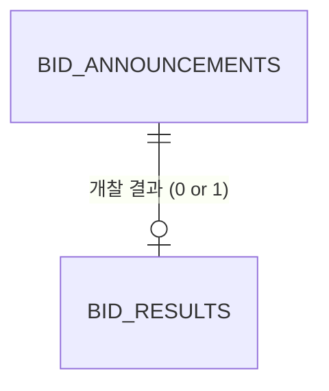

# BidWise — 데이터 모델

> **무엇을 어디에 왜 저장하는지 적는 문서다.** 컬럼 · 타입 · 제약은 옮기지 않는다 — 원본은 [`backend/app/models.py`](../backend/app/models.py)와 `backend/alembic/versions/`.
> API 필드 ↔ 컬럼 대응은 `backend/app/transformer/`, 집계 쿼리는 `backend/app/repository/bid_repo.py`.

---

## 1. 테이블

데이터가 **서로 다른 두 API**에서 오므로 테이블도 둘이다. 면허제한정보는 테이블을 따로 두지 않고 공고의 칸(`lcns_lmt_nm`)에 첫 면허만 적는다.

| 테이블 | 무엇 | 출처 (나라장터) |
|---|---|---|
| `bid_announcements` | "이런 공사가 나왔습니다" — 공고 게시글 + 정제 결과 | 입찰공고정보서비스 `getBidPblancListInfoCnstwk`, 면허는 `getBidPblancListInfoLicenseLimit` |
| `bid_results` | "이 공사, 누가 얼마에 따갔습니다" — 결과 발표문 | 낙찰정보서비스 `getScsbidListSttusCnstwk` |

---

## 2. 관계 — 공고 1 : 결과 0..1

**왜 최대 1개인가**: 경쟁을 거쳐 한 업체가 공사를 따간다. `announcement_id`의 UNIQUE가 DB에서 강제한다.
낙찰정보 행은 (번호, 차수) 말고도 분류(`bidClsfcNo`) · 재입찰(`rbidNo`)로 더 쪼개져 오는데, **재입찰번호가 가장 큰 최종 결과 하나만** 저장한다 (`transformer/result.py`).

**왜 0개일 수 있는가**: 개찰 전이거나 유찰된 공고는 낙찰정보 API에 행 자체가 없다. 필드가 NULL인 게 아니다.

> 비유: 공고 = 시험 접수 명단, 결과 = 합격자 발표 명단. 접수한 사람이 모두 합격자 명단에 오르진 않는다. 아직 발표 전일 수도, 시험이 무산됐을 수도 있다.

**영향**
- 집계는 `INNER JOIN`이 아니라 `LEFT JOIN`이다. 개찰 전 공고가 통계에서 사라지면 안 된다. `COUNT(*)`는 전체, `COUNT(r.id)`는 완료 건, `AVG()`는 NULL을 뺀다 — 한 쿼리에서 다 뽑는다.
- "전체 공고 수"와 "낙찰률을 낸 공고 수"가 다르다. API와 화면에서 둘을 나눠 보여 준다.

**공고의 유일성**: `bid_ntce_no`만으로는 유일하지 않다. 정정 · 재공고는 번호가 그대로이고 차수(`bid_ntce_ord`)만 오른다 → `(bid_ntce_no, bid_ntce_ord)`. 차수가 다르면 별개의 공고 행이다. 숫자 PK(`id`)를 따로 둬서 UPSERT해도 결과의 연결이 끊기지 않는다.

---

## 3. 왜 이렇게 저장하는가

### 3.1 지역: 수요기관이 아니라 공사현장

처음엔 `dminsttNm`(수요기관명)에서 지역을 뽑으려 했다. 응답을 보니 `cnstrtsiteRgnNm`(공사현장지역명) 전용 필드가 있고 수의계약에도 채워져 있었다. 수요기관 소재지와 실제 공사 현장은 다를 수 있고, 지역 경향을 보려면 공사가 벌어지는 위치가 맞다.

정규화 결과는 `region_normalized`에 따로 저장한다. 매번 문자열을 잘라 `GROUP BY` 하면 인덱스를 못 쓴다.

**지역은 16개다.** 광주 · 전남이 `전남광주통합특별시` 하나로 와서 `전남광주`로 둔다. 구 이름으로 나눌 수 있어도 시/도만 적힌 104건은 나눌 수 없다 (2026-10-26 실측). 표는 `transformer/region.py`가 원본이다.

### 3.2 공종: 원본과 정제값을 나란히

`main_cnstty_nm`은 비어 있을 수 있고(수의계약에서 주로, 규칙은 아님 — 하루치 571건에서 수의계약 417건 중 8건에 있고 경쟁입찰 일부엔 없음) 값도 공종이 아니라 면허 업종 47종이다. 그래서 값이 있는지만 보고, 대분류 11개로 묶어 `category`에, 출처를 `category_source`에 적는다. 결정과 수치는 [0004](decisions/0004-category-fallback.md).

원본은 그대로 두고 손질한 값을 옆 칸에 적는다. 면허 이름(`lcns_lmt_nm`)도 원본으로 두어야 규칙을 고쳤을 때 API 없이 `python -m app.reclassify`로 다시 계산할 수 있다.

컬럼을 더하는 시점은 "필요성"이 아니라 "그 시점에 값을 채울 로직이 있는가"로 정했다. 로직 없이 만들면 "원래 없음"과 "아직 안 채움"이 구분되지 않는다.

### 3.3 낙찰률: 저장만 하고 계산하지 않는다

낙찰정보 API가 `sucsfbidRate`를 이미 계산해서 준다. 우리가 가진 `presmpt_prce`는 **추정가격**이지 **예정가격**이 아니다. 예정가격은 복수예비가격 추첨 등을 거쳐 정해져 응답에 나오지 않으므로, 직접 계산하면 API와 다른 숫자가 나온다.

### 3.4 타입과 시간

- 낙찰률은 `NUMERIC(6,3)`. 평균 · 집계의 핵심 지표라 부동소수점 오차가 쌓이면 안 된다.
- 금액은 `BIGINT`. 실측 최대 예산 4,506억 원으로 `INTEGER`(약 21억)를 넘는다.
- 공고 일시는 API가 준 한국 시간 그대로, `fetched_at`은 UTC로 저장한다. 시간대를 붙여 넣으면 PostgreSQL이 세션 시간대로 바꿔 9시간 어긋난다.

---

## 4. 열린 질문

- [ ] 수집 이력 테이블(`fetch_logs`)을 둘지 — 지금은 `fetched_at`만 있어 "어제 수집이 실패했는지" 알기 어렵다
- [x] 공종 분류를 컬럼에 저장할지 → **결정됨: 저장** (2026-09-12, 2026-10-26 구현)
- [x] 지역 정규화를 컬럼으로 둘지 → **결정됨: `region_normalized`** (2026-09-12, 2026-10-26 구현)
- [x] 유찰 / 재공고 취급 → **결정됨**: 2장 (2026-10-26, `transformer/result.py`)
