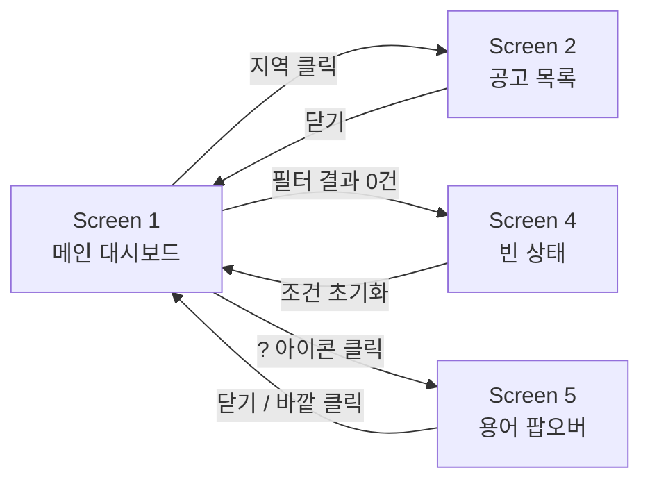

# BidWise — 화면 설계

> **화면 목록 · 이동 · 화면별 규칙 · 색 · 서체 · 빈 상태 · 문구를 적는 문서다.** 규격 · 색의 단일 출처는 이 문서이고, 그림은 [mockups/](mockups/README.md)다.
> 프론트엔드는 아직 코드가 없다 (M3부터). 기능 범위는 [REQUIREMENTS](REQUIREMENTS.md), API 필드는 [ARCHITECTURE](ARCHITECTURE.md) 3장.

---

## 1. 디자인 방향

실무 입찰 서비스는 텍스트 · 표 위주로 조밀하다. BidWise는 "시장 전체를 조망하는 학습 도구"라 여백이 있고 **지도가 주인공인** 대시보드 톤이다. 데스크탑 1440px 우선, 다크 톤 한 벌.

### 색 — 건설 도메인에서 가져왔다

뻔한 SaaS 팔레트를 피하고 주제(공사 · 도면 · 청사진)에서 색을 끌어왔다.

| 토큰 | 값 | 용도 |
|---|---|---|
| `bg/base` | `#12151A` | 콘크리트 그레이 — 화면 배경 |
| `bg/surface` | `#1A1E26` | 카드 배경 |
| `bg/elevated` | `#232833` | 활성/선택 상태 배경 |
| `border/subtle` · `border/strong` | `#2E3440` · `#3D4453` | 구분선 |
| `text/primary` · `secondary` · `muted` | `#E8EBF0` · `#8B94A6` · `#5C6679` | 텍스트 위계 |
| `accent/safety` | `#F2C12E` | 안전모 옐로우 — **정말 눈에 띄어야 할 곳에만** |
| `data/blue-100~900` | `#1B2A40` → `#7CC6FF` | 청사진 블루 스케일 — 지도 · 차트의 데이터 표현 전용 |
| `status/done` · `status/pending` | `#3DD68C` · `#6B7689` | 낙찰완료 / 개찰 전 |

**강조색을 하나만 쓴 이유**: 노란색이 흩어지면 뭐가 진짜 중요한지 신호가 흐려진다. 선택된 지역, 핵심 지표, 액션 버튼에만 쓴다.

### 서체

**IBM Plex Sans KR 하나만** 쓴다. Noto Sans KR보다 숫자 형태가 또렷해 지표 중심 대시보드에 맞고, 이 규모에서 위계는 굵기와 크기로 충분하다.

| 역할 | 스펙 | 용도 |
|---|---|---|
| Display | 30 / Light / -2% | 요약 카드의 큰 숫자 |
| H1 | 19 / SemiBold | 화면 제목 |
| H2 | 16 / SemiBold | 카드 제목 |
| Body | 13 / Medium | 리스트 항목 제목 |
| Caption | 11 / Regular | 보조 설명 |

---

## 2. 화면 목록과 이동

| 화면 | 유즈케이스 ([REQUIREMENTS](REQUIREMENTS.md) 2장) | 목업 |
|---|---|---|
| Screen 1 — 메인 대시보드 | UC1 ~ UC4 | `Dashboard.desktop.html` |
| Screen 2 — 지역 선택 → 공고 목록 | UC5 | `Region.desktop.html` |
| Screen 3 — 토큰 & 컴포넌트 참고 시트 | (구현 참고용) | `Tokens.html` |
| Screen 4 — 빈 상태 (결과 0건) | UC4의 예외 경로 | `Empty.desktop.html` |
| Screen 5 — 용어 팝오버 열린 상태 | | `Glossary.desktop.html` |

---

## 3. Screen 1 — 메인 대시보드

**구성**: 헤더 / 필터바 / 요약 카드 4개 / 지도 + 랭킹 / 공종별 차트

### 요약 카드 4개

| 카드 | API 필드 | 설계 포인트 |
|---|---|---|
| 전체 공고 | `total_announcements` | 큰 숫자 아래 "개찰완료 9,302 · 진행중 3,545"로 병기 |
| 평균 낙찰률 | `avg_sucsfbid_rate` | 유일하게 강조색 — 핵심 지표. 서브텍스트 "개찰완료 9,302건 기준" |
| 총 예산 규모 | `total_budget_amt` | "억원"으로 변환 (원 단위는 자릿수 때문에 안 읽힘) |
| 평균 참가업체 | **API에 없다** ([ARCHITECTURE](ARCHITECTURE.md) 7장) | 서브텍스트 "경쟁이 치열할수록 낙찰률 하락" |

서브텍스트 "기준"을 넣는 이유: 전체가 아니라 완료 건만으로 낸 평균이라는 걸 감추면 통계가 왜곡되어 보인다.

### 지도 + 랭킹 패널

- **지역은 16개다** (광주 · 전남은 `전남광주` 하나). GeoJSON의 두 영역을 하나로 합쳐야 한다. 목업은 묶음이 더 많은 옛 안이다.
- 지도는 `avg_sucsfbid_rate`를 5단계 블루로 칠한다. **구간을 고정 5등분하지 않는다.** 2026-10-26 실측으로 지역 평균이 90.26 ~ 91.69%에 몰려 있어 80 ~ 100%를 5등분하면 전국이 한 색이 된다. 실제 값 범위나 분위수로 나누고 범례에 실제 수치를 적는다. 차이가 작다는 사실도 화면에서 정직하게 보여 준다.
- `avg_sucsfbid_rate`가 `null`인 지역은 "데이터 없음" 색.
- 랭킹 패널은 같은 데이터를 막대로 다시 표현한다. 지도는 공간 감각에, 랭킹은 정확한 순서 비교에 강해 서로 보완한다.
- 지역명에는 `?` 아이콘을 달지 않는다 — 일반 지명이라 설명이 필요 없다.

### 공종별 차트의 출처 표시

| 배지 | 의미 | 근거 |
|---|---|---|
| (없음) | 업종(`main_cnstty`) 또는 면허(`license`)로 분류 | 공식 값 — 신뢰도 높음 |
| `추정` (옐로우 테두리) | 공고명 키워드로 분류 | 우리가 만든 규칙 |
| `분류없음` (회색 테두리) | 분류 실패, `미분류` 막대 | — |

한 대분류 안에 추정이 섞이므로 지금 쿼리는 추정 건수(`keyword_count`)를 준다. 막대 단위 배지로 갈지 비율로 보여 줄지는 M4 전에 정한다 ([ARCHITECTURE](ARCHITECTURE.md) 7장).

분류 방식이 다른 데이터를 똑같은 얼굴로 보여 주면 정확도를 과신하게 된다.

---

## 4. Screen 2 — 지역 선택 → 공고 목록

### 지도 상태

- 선택된 지역: 옐로우 테두리(3px)
- 나머지: `opacity: 0.3`. 아예 지우면 "전국 중 이 지역"이라는 맥락이 끊겨서 흐리게만 한다
- 지역 필터 셀렉트도 활성 상태(옐로우 테두리)로 동기화

### 공고 카드의 3가지 상태

| 상태 | 조건 | 화면 |
|---|---|---|
| 낙찰완료 | `result` 있음 | 초록 배지 + 낙찰률(파란 강조 숫자) + 참가업체 수 |
| 개찰 전 | `result: null` | 회색 배지 + "OO 개찰 예정" 날짜 |
| 선택됨 | 프론트 로컬 상태 | 옐로우 테두리 2px + 배경 한 단계 밝게 |

같은 목록에 "낙찰완료"와 "개찰 전"이 섞이는 것이 정상이다. 정렬 탭: 최신순 / 낙찰률순 / 금액순.

---

## 5. Screen 4 — 빈 상태

API는 빈 결과를 에러로 보지 않는다. 빈 화면만 보여 주면 오류로 오인하므로 세 가지를 함께 보여 준다.

1. **무슨 일** — "조건에 맞는 공고가 없습니다"
2. **왜** — "제주 지역의 철도·궤도 일반경쟁 공고는 최근 1개월간 등록되지 않았습니다" (걸린 조건을 구체적으로 되짚는다)
3. **뭘 하면 되는지** — "기간 넓혀보기" / "조건 초기화" 버튼

### 액션 버튼 문구는 "제안"이지 "보장"이 아니다

"기간 1년으로 넓히기"는 눌러도 결과가 나온다는 보장이 없다. 조건별 결과 수를 미리 알려 주는 API도 없다.

| 안 | 내용 | 채택 |
|---|---|---|
| A | "조건 초기화"만 남김 | 편의성이 떨어짐 |
| **B** | 필터 값만 바꿔 주는 제안으로 남기되 결과를 확정하지 않음 | **채택** |
| C | 백엔드가 조건별 카운트를 미리 계산 | MVP 범위 밖, 새 API 필요 |

"제안"과 "약속"을 구분하면 정직성 문제가 풀린다. 검색엔진의 "다른 검색어를 시도해 보세요"도 이 방식이다.

---

## 6. Screen 5 — 용어 팝오버

화면에 적산 · 낙찰률 · 주공종 · 수의계약 같은 용어가 그대로 나오는데, 목표 사용자는 이 분야를 모르는 학습자다.

### Tooltip이 아니라 Popover

| | Tooltip | **Popover (채택)** |
|---|---|---|
| 트리거 | 호버 | 클릭 |
| 유지 | 벗어나면 닫힘 | 바깥을 클릭할 때까지 |
| 터치 기기 | 동작 안 함 | 정상 동작 |
| 내용 길이 | 한두 단어 | 여러 줄 |

정의 + 공식 + 비유 + 출처까지 4 ~ 5줄이라 Tooltip은 읽는 도중 닫힌다.

### 설명 구조 — 4단계 고정

1. **한 줄 정의** — 전문 용어 없이
2. **공식/기준** (해당할 때) — 계산식 그대로
3. **"쉽게 말하면"** — 실생활 비유. 왼쪽에 옐로우 바
4. **출처** — API 원본 필드명

### 용어 사전 8종

Figma Screen 3에서 옮겼다. 정의와 비유의 원본은 이 표다.

| 용어 | 정의 | 쉽게 말하면 | 출처 |
|---|---|---|---|
| 낙찰률 | 공사를 따낸 금액이, 정부가 미리 잡아둔 기준 금액의 몇 %인지를 나타내는 값. 공식: 낙찰금액 ÷ 예정가격 × 100 | 정부가 10억쯤 들겠다고 잡아둔 공사를 9억에 따냈다면 낙찰률은 90%. 낮을수록 경쟁이 치열했다는 뜻 | `sucsfbidRate` |
| 예정가격 | 발주처가 "이 정도면 적정하다"고 미리 정해 둔 상한 기준 금액. 낙찰률 계산의 분모 | 물건 살 때 마음속으로 정해 둔 최대 지출 한도 같은 것 | API 직접 미제공 |
| 추정가격 | 부가세와 관급자재를 빼고 순수하게 공사에만 드는 것으로 추정한 금액 | 예정가격보다 앞 단계의, 더 날것에 가까운 견적 | `presmptPrce` |
| 공종(주공종) | 그 공사가 어떤 종류의 일인지 나타내는 분류. 건축 · 토목 · 조경 · 소방설비 등 | 같은 "공사"라도 건물 짓는 일과 도로 까는 일은 완전히 다른 종목 | `mainCnsttyNm` |
| 수의계약 | 경쟁 입찰 없이 발주처가 특정 업체를 골라 계약하는 방식. 주로 소규모 공사 | 동네 가게에 바로 전화해서 맡기는 것에 가까움. 이 경우 주공종명이 비어 있는 일이 많다 | `cntrctCnclsMthdNm` |
| 제한·일반경쟁 | 자격을 갖춘 업체들이 가격을 써내 경쟁하는 방식. 제한경쟁은 참가 자격을 좁힌 것 | 여러 곳에서 견적을 받아 가장 유리한 곳을 고르는 것 | `cntrctCnclsMthdNm` |
| 개찰 | 제출된 입찰서를 열어 낙찰자를 정하는 절차. 이 시점이 지나야 낙찰 결과가 생긴다 | 봉투를 여는 날. 그 전까지는 결과가 존재하지 않는다 | `opengDt` |
| 유찰 | 참가 업체가 없거나 자격 미달로 낙찰자가 정해지지 않은 상태. 보통 재공고로 이어진다 | 응모가 없어 당첨자를 못 뽑은 상황 | — |

"예정가격"과 "추정가격"을 나눈 이유: 개발자도 처음에 헷갈린 개념이다 ([DATA_MODEL](DATA_MODEL.md) 3.3절).

수의계약의 "주공종명이 비어 있다"는 경향이지 규칙이 아니고, 공종의 예시 "소방설비"는 지금 대분류로는 "소방"이다. 구현할 때 문구를 다듬는다.

### 적용 대상 (Screen 1)

`?` 아이콘은 평균 낙찰률, 평균 참가업체, 공종별 평균 낙찰률, 계약방법 필터 4곳에만 단다. 남발하면 정말 낯선 용어가 어디인지 신호가 흐려진다.

---

## 7. shadcn/ui 컴포넌트 매핑

| 화면 요소 | 컴포넌트 |
|---|---|
| 상단 기간 선택 | `Tabs` 또는 `ToggleGroup` |
| 지역 · 공종 · 계약방법 필터 | `Select` |
| 요약 통계 카드 | `Card` + `CardHeader` / `CardContent` |
| 공고 카드 | `Card` + `Badge` |
| 낙찰완료 / 개찰 전 | `Badge` (`variant="outline"`) |
| 지역 랭킹 막대 | `Progress` |
| 닫기 · 조건 초기화 | `Button` (`variant="outline"` / `"ghost"`) |
| 용어 설명 | `Popover` |
| 빈 상태 액션 버튼 | `Button` (`variant="default"` — 강조색 사용처) |

---

## 8. 열린 질문

- [ ] 로딩 상태(스켈레톤) — 목업에 없다. 실제 API 응답 속도를 보고 정한다
- [ ] 모바일/반응형 — L 기능. 데스크탑 1440px 우선
- [ ] 공고 목록이 길 때(수천 건) 페이지네이션 — 무한 스크롤 vs 페이지 번호, 어떻게 안내할지
- [ ] 빈 상태 "기간 넓혀보기"를 눌렀을 때 필터만 바꾸고 재조회하는 정확한 동작
- [ ] 용어 팝오버를 터치에서 어떻게 트리거할지 — 클릭과 같을 것으로 예상하나 미검증
